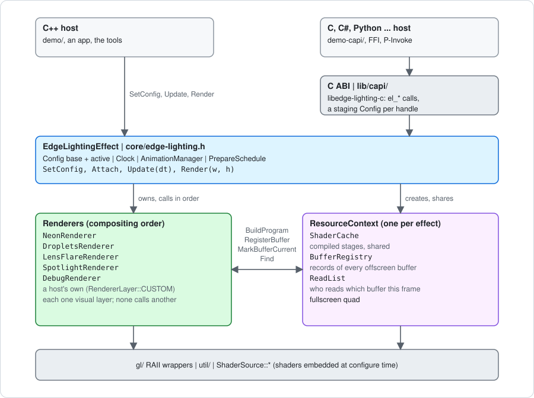
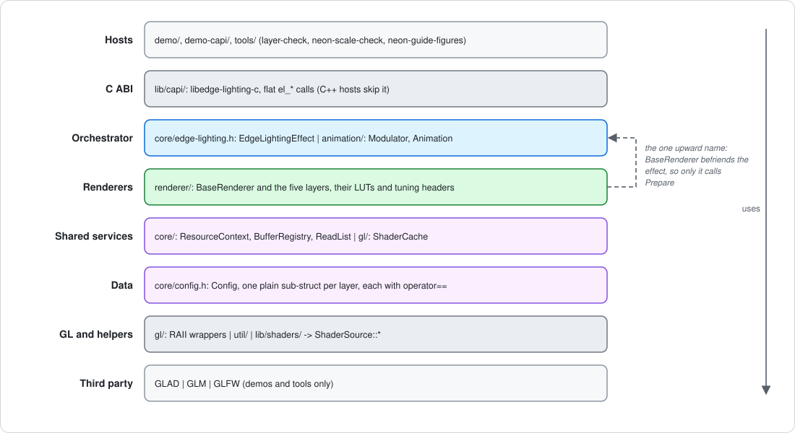
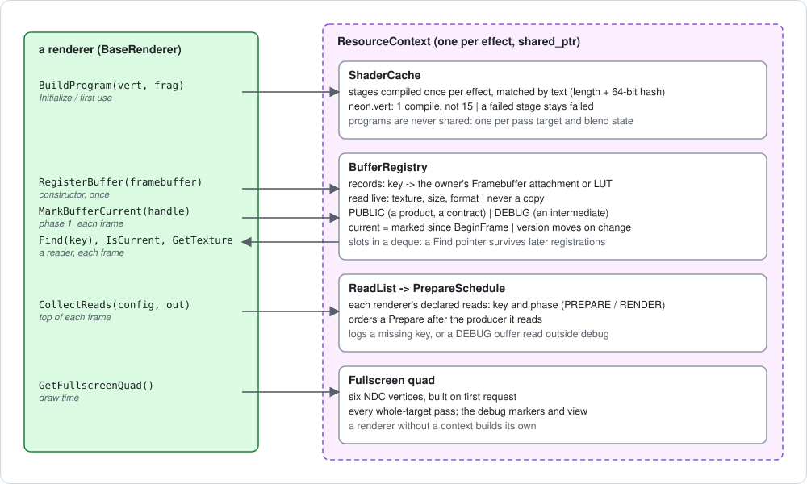
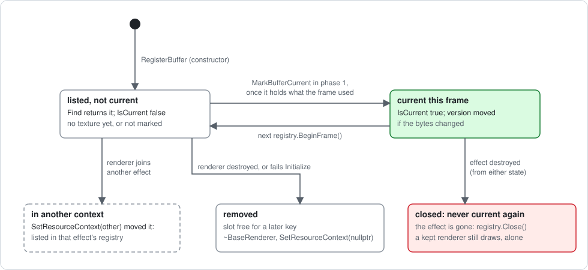

# Architecture

The library as a system: its components and the direction they depend in, who
owns what and for how long, how one frame moves through it, how renderers
share resources and read each other's output, the rules every part keeps, and
where a change goes in. It is the map. The ground it covers in depth is
elsewhere:

- [`implementation.md`](implementation.md) - the C++ side in brief: the
  artifacts, the renderer contract, change detection, shader embedding, the C
  ABI, coordinate spaces, the demos.
- [`neon-onboarding-guide.md`](neon-onboarding-guide.md) - the neon from first
  principles: every pass, buffer and config field.
- [`resource-sharing-plan.md`](resource-sharing-plan.md) - why the sharing
  layer (section 4 here) is shaped as it is, and what each of its steps
  measured.

When this page and the headers under `lib/include/` disagree, the headers win.

The diagrams are SVG files in [`images/architecture/`](images/architecture/),
drawn by `diagrams.py` there: to change one, edit the script and run
`python3 docs/images/architecture/diagrams.py`, rather than editing the SVG.

---

## 1. The system at a glance



The effect is an orchestrator: it holds state and forwards calls, and draws
nothing itself. Every pixel comes from a renderer, a self-contained visual
layer that blends onto the caller's framebuffer in list order. Renderers do not
call each other. They meet in two places only: the caller's framebuffer, where
the order decides what lands on what, and the `ResourceContext`, where they
share compiled stages and one quad, and one can read a buffer another made.

---

## 2. Components and layering

| Directory | Component | Depends on |
| --------- | --------- | ---------- |
| `lib/include/util/`, `lib/src/util/` | Geometry, colour, capture, logging, GL state scopes | GLAD, GLM |
| `lib/include/gl/` | Move-only RAII wrappers: `ShaderObject`, `ShaderProgram`, `ShaderCache`, `VertexArray`, `Framebuffer`, `UniformBuffer`, `Texture2D` | util |
| `lib/include/core/config.h` | `Config`: plain data, one sub-struct per layer, each with `operator==` | GLM |
| `lib/include/core/` (the rest) | `ResourceContext`, `BufferRegistry`, `ReadList` / `PrepareSchedule`, `EdgeLightingEffect` | gl, config, renderer |
| `lib/include/renderer/` | `BaseRenderer`, the five renderers, their LUTs and tuning headers | gl, util, config, the context's headers |
| `lib/include/animation/` | `Modulator`, `Animation`, `AnimationManager`, presets, `FieldBoundAnimation` | config |
| `lib/shaders/` | GLSL sources and shared chunks, embedded as `ShaderSource::*` | the tuning headers |
| `lib/capi/` | `libedge-lighting-c`: the flat C ABI over the effect | everything above |
| `demo/`, `demo-capi/` | ImGui hosts: one on the C++ API, one on the C ABI alone | the library or the ABI |
| `tools/` | `neon-scale-check`, `layer-check`, `neon-guide-figures`, and `common/PassRecorder` | the static library |



Two things about the direction are deliberate:

- **The renderers and the effect depend on each other only through
  `BaseRenderer`.** The effect calls the base class, and nothing in a renderer
  names the effect. `BaseRenderer` names the effect once, as a friend, so that
  only the effect can call `Prepare` (section 3).
- **The shared services sit below the renderers and above the GL wrappers.**
  `ResourceContext` knows nothing about any renderer. A record holds a
  `const BaseRenderer *` for identity, never to call it.

### 2.1 The parts, one line each

- **`Config`** (`core/config.h`) - `geometry`, `neon`, `droplets`, `lensFlare`,
  `spotlight`, `debug`. Plain values, copied freely. Every sub-struct compares
  all its fields: the effect's change detection and every renderer's dirty
  flags depend on it.
- **`EdgeLightingEffect`** (`core/edge-lighting.h`) - keeps the authored
  (base) config and the active one (base plus animation overlays), the clock,
  the animation manager, the renderer list and its layer order, the context,
  and the `PrepareSchedule`.
- **`BaseRenderer`** (`renderer/base-renderer.h`) - the renderer contract
  (section 3), and a renderer's view of the context: `BuildProgram`,
  `RegisterBuffer`, `MarkBufferCurrent`, `GetBufferRegistry`,
  `GetFullscreenQuad`, `IsBufferWanted`.
- **The five renderers**, in default order:

  | Layer | Draws | Offscreen buffers | Detail |
  | ----- | ----- | ----------------- | ------ |
  | `NeonRenderer` | The glow, its edge ring, the opaque fill | Emission table, coverage tables, gather, reduced buffer, two fields | [`neon-onboarding-guide.md`](neon-onboarding-guide.md) |
  | `DropletsRenderer` | Rain-on-glass in a band round the rect | none | [`effect-reference.md`](effect-reference.md) |
  | `LensFlareRenderer` | Sun and hex-aperture flare | The reduced buffer, below scale 1.0 | [`lens-flare-perf-review.md`](lens-flare-perf-review.md) |
  | `SpotlightRenderer` | Freely placed cones of light, screened | The reduced buffer, below scale 1.0 | [`spotlight-renderer.md`](spotlight-renderer.md) |
  | `DebugRenderer` | LUT strip, stop markers, bounding box, buffer view | none | `renderer/debug-renderer.h` |

- **`ResourceContext`** (`core/resource-context.h`) - what the renderers of
  one effect share: the `ShaderCache`, the `BufferRegistry`, the frame's
  `ReadList`, and one fullscreen quad. Section 4.
- **Animation** - `Modulator` (pure `time -> float`), `Animation` (modulators
  plus play state, `Update` then `Apply`), `AnimationManager` (the attach
  list). The effect runs the manager, so a host attaches and plays and never
  composites by hand.
- **The C ABI** - three opaque handle families (effect, animation, modulator).
  Each effect handle has a staging `Config` that the setters write and
  `el_effect_update` hands to the effect. Enum parity is checked by
  `static_assert`s in `capi-internal.h`, and no exception crosses the boundary.
- **Shaders** - read by CMake at configure time into
  `build/lib/generated/shaders.h`. Shared chunks (`neon-common`, `-pieces`,
  `-sdf`, `-mask`, `-grade`, `spotlight-dither`) and the tuning headers are
  spliced in by placeholder, since GLSL has no `#include`.

---

## 3. A frame

A host makes two calls per frame. `Update` changes state and draws nothing.
`Render` draws and changes no config.


In steps:

```
Update(dt)
  animations.Update(clock.Update(dt))         the clock's delta: 0 while paused
  active = base + every animation's Apply
  active config changed?  --yes-->  renderer.OnConfigChanged(active)   for each
  renderer.Update(dt, time, active)                                    for each

Render(w, h)
  registry.BeginFrame()                       nothing is current any more
  reads.Clear(); renderer.CollectReads(active, reads)                  for each
  order = PrepareSchedule::Build(renderers, generation, reads, registry)
  renderer.Prepare(w, h, time, active)        in that order    -- PHASE 1
      -> RenderOffscreen: own buffers only; marks them current
  renderer.Render(w, h, time, active)         compositing order -- PHASE 2
      -> RenderOnscreen: the caller's framebuffer only
```

**Why two phases.** Every offscreen pass of every layer runs before anything
touches the caller's framebuffer, so that target is drawn in one unbroken run.
On a tile-based GPU each switch away from a target and back stores its tiles
out and loads them in again. It also means any layer's `Render` can read any
layer's buffer, wherever the two sit in the order: everything is made, and
marked current, in phase 1.

**The contract that makes it safe.**

- `BaseRenderer::Render` is not virtual. It runs `RenderOffscreen` itself
  unless the effect's `Prepare` already did this frame, then
  `RenderOnscreen`. A renderer overrides those two halves and cannot forget
  phase 1 or return before it. A renderer drawn without an effect calls
  `Render` and gets its whole frame.
- `Prepare` is private, the effect's alone, and the effect always follows it
  with that frame's `Render`. So a prepared frame is never left for a later
  one to composite.
- Between a renderer's `Prepare` and its `Render`, every other layer's
  `Prepare` runs. A `Render` therefore sets every piece of GL state it reads -
  blend, texture and uniform-block bindings - and inherits nothing from its
  own phase 1. What phase 2 needs from phase 1 crosses in members (the neon's
  `mFramePlan`, the flare's and the spotlight's `mScaledDrawn`).
- Each phase hands back what it was handed: the framebuffer (which may be a
  capture's FBO, never assume 0), the viewport, and blending on with
  `GL_SRC_ALPHA, GL_ONE_MINUS_SRC_ALPHA`.

**Change detection** is what keeps an idle frame cheap. `OnConfigChanged`
fires only when the composited config actually changed, and each renderer
gates every rebuild on the fields that feed it. The neon also skips whole
passes on frames where their inputs did not move, keyed on what the pass binds
(upload counts, versions, the viewport) rather than on a list of fields.

---

## 4. Sharing between renderers

One `ResourceContext` per effect, held by `shared_ptr` by the effect and by
every renderer it registers (`AddRenderer` hands it over before it initialises
a late renderer). It holds four things.



### 4.1 Stages, not programs: `ShaderCache`

`BaseRenderer::BuildProgram(vert, frag, name, defines)` links a program from
stages the cache compiled once per effect: `neon.vert` once instead of once
per program (15 times in `layer-check startup`'s frame on `main`),
`neon.frag` once for its two programs. Startup compiles 21 stages where
`main` compiled 36, though the time barely moves: this driver finishes a
compile on the first draw (`progress-log.md`, 2026-10-16). A stage is matched by its text -
length plus a 64-bit hash - so a source need only live through the call. A
stage that failed to compile stays failed: logged once, never compiled again.

Programs are never shared. Every pass keeps a program object of its own,
because one program drawing an offscreen buffer unblended and the caller's
framebuffer blended in one frame measured 93-624x slower on the AMD macOS
driver (`neon-resolution-scale-plan.md` section 7, build AB).

### 4.2 Records of buffers: `BufferRegistry`

Every offscreen buffer a renderer owns is registered once, from its
constructor, under a string key: the `Framebuffer`'s name, plus `[n]` for
attachment n > 0, or a key of its own for a product. Today's keys are:

| Owner | Keys |
| ----- | ---- |
| `NeonRenderer` | `Emission`, `GlowCover`, `GlowCoverSegments`, `Gather`, `Gather[1]`, `Field`, `Scaled`, `RingField`, `GradientRing` (a LUT), `Glow`, and `Composite` (only while `compositeScale` > 0), all prefixed `NeonRenderer.` |
| `LensFlareRenderer` | `LensFlare.Scaled` |
| `SpotlightRenderer` | `Spotlight.Scaled` |

A record REFERS to the owner's `Framebuffer` or LUT; texture, size and format
are read live, so a record cannot go stale. It lives exactly as long as its
owner (`~BaseRenderer` removes it, `SetResourceContext` moves it). Each frame
the owner marks the records it used - drawn, or a cache it checked - in phase
1, and `IsCurrent` answers "marked since this frame began, and allocated". A
record's `version` moves when its bytes may have changed, from one
registry-wide counter, so a value never repeats under a key. Slots live in a
deque, so a pointer from `Find` stays valid when other renderers register
later.



Every record is either:

- **`PUBLIC`** - a product with a written contract that any layer may bind.
  Two exist: `NeonRenderer.Glow` and `NeonRenderer.Composite`.
- **`DEBUG`** - an intermediate its producer may change with any
  optimisation. The debug layer's buffer view and a host UI read these; any
  other layer reading one is logged.

### 4.3 Who reads what: `ReadList` and `PrepareSchedule`

At the top of each frame every renderer declares, in `CollectReads`, each key
it will bind and in which phase (`ReadPhase::PREPARE` or `RENDER`).

- **Order.** The schedule runs the `Prepare` calls in compositing order,
  except that a renderer whose `Prepare` reads another's product runs after
  its producer. This is a stable topological sort; a cycle is refused,
  logged, and run in compositing order. A `RENDER` read needs no ordering,
  since every product is made in phase 1.
- **Demand.** `IsBufferWanted` tells a producer whether anything reads a
  buffer this frame, so an on-demand product could be made only then. No
  such product exists yet.
- **Diagnostics.** These are logged once per read, not per frame: a key no
  buffer has, an over-long key, and a `DEBUG` buffer read by a layer other
  than the debug layer. They re-run when the reads change, or when the
  renderer list or the registry changes (by generation counter).

The only reader in the library today is the debug layer: its buffer view's
selection, and the neon's colour ring for the LUT strip.

### 4.4 The glow product

`NeonRenderer.Glow` is the reduced buffer, published under a contract
(`NeonRenderer::GLOW_KEY` in `neon-renderer.h`, in full). It holds the glow's
halo and bloom, premultiplied and tone-mapped, BEFORE the edge mask and
WITHOUT the filament. It sits at `resolutionScale` over the box its record is
placed at, and is current on every frame the glow is drawn. A reader applies
the mask itself: `neonEdgeMask` from `neon-mask.glsl`, fed by
`NeonRenderer::GetEdgeMask` / `UploadEdgeMask`, the very values the blit uses.
The contract binds the neon: an optimisation that masks the buffer, moves the
halo or bloom out of it, or skips pass 1b on a frame it is marked current
breaks every reader. The one pilot reader (droplets lit by the glow) was built
and dropped; the product stays.

### 4.5 The shared buffer

`NeonRenderer.Composite` (`NeonRenderer::COMPOSITE_KEY`; in progress, see the
progress log) is the whole neon layer - fill, glow, line, cut and cutoffs - at
`NeonConfig::compositeScale` `s`, made only while that is above 0. Pass 1s
draws it in phase 1 with the main frame's three passes, each with a program
object of its own:

- the **fill**, at `s`;
- the **blit**, a copy of the reduced buffer masked in the shared buffer's
  pixels;
- the **ring**, shaded again at `s` from the gather.

So only the ring band is shaded twice. It is undithered (a reader dithers when
it writes 8 bits), reused on frames where nothing moved, and released at 0. At
`s` = 1 the main frame becomes one copy of it, so the layer is drawn once
instead of twice. Turning it on leaves the main frame byte-identical: its meshes
are clamped to the main frame's area, so the main frame's buffers do not grow.

### 4.6 One quad

The context builds one six-vertex NDC quad on first request. Every
whole-target pass draws it through `BaseRenderer::GetFullscreenQuad()`, as do
the debug layer's markers and buffer view, which place it with a model matrix.
Without a context a renderer builds its own. Ask for it at draw time: it
changes with the context.

### 4.7 The rules every sharer keeps

From `resource-sharing-plan.md` section 2:

1. **One writer.** Only the owner writes a buffer. A reader samples it and
   does nothing else: no render, resize, `glTexParameter` or mipmaps.
2. **The producer's caches stay its own.** No read triggers a re-bake or
   defeats a skip.
3. **One program object per pass target and blend state** (4.1).
4. **The restricted GL targets.** No bare uniform arrays; a float target
   always has a fallback format; one GL context.
5. **Steady state allocates nothing**, and records stay trivially copyable.
6. **Host state stays the host's** (section 3).
7. **Byte-identical** for every change that is not a feature (section 7).

---

## 5. Ownership and lifetimes


| Object | Owner | Lifetime |
| ------ | ----- | -------- |
| `Config` base / active | the effect | the effect's; renderers get `const &` per call |
| renderers | the effect (`shared_ptr`), and the host if it kept one | the last holder's |
| `ResourceContext` | the effect and every renderer in it (`shared_ptr`) | the last holder's; destroy with the GL context current |
| a stage (`ShaderObject`) | the `ShaderCache` | the context's; a linked program keeps it alive in GL |
| a program, framebuffer, LUT, VAO, UBO | the renderer, by RAII member | the renderer's |
| a buffer record | the renderer that registered it | registered in its constructor, removed in its destructor, moved by `SetResourceContext` |
| animations | the host (`AnimationPtr`) | attaching does not transfer ownership |

The cases at the edges, all deliberate:

- **An effect destroyed while the host keeps a renderer.** The context lives
  on with the renderer, but the effect closes its registry and clears its
  read list on the way out. The renderer still draws alone; nothing it marks
  reads as current, since there is no frame for "current" to describe.
- **One renderer in two effects.** The later effect wins: joining it moves
  the renderer's records there. If the renderer then fails to initialise in
  the new effect, it goes back to the context it came from, where the first
  effect still draws it.
- **A renderer that fails `Initialize`** is dropped from the effect and
  leaves its context, so its keys are free for a replacement.
- **The same renderer added twice** is refused: it would draw twice a frame.

---

## 6. How data moves between layers

There are exactly two channels.


- **The framebuffer.** Each layer composites premultiplied over what is
  already there (the spotlight screens). Every layer writes a coverage alpha,
  never a literal 0. A compositor or video plane that blends the surface by
  alpha would otherwise drop the layer: the Tizen bug.
- **The registry.** A reader finds a record by key, checks `IsCurrent`, and
  binds `GetTexture()` for sampling. A placed record says which box of the
  frame its texels span (uv = (p - origin) / size); a table maps onto no box.

No other channel exists: no renderer holds a pointer to another or reads
another's members. Each reads its own sub-config and the shared `geometry`,
and three read across, each on purpose and documented in place:

- the neon reads `debug.opaqueOnly`, a mode of its own pass schedule;
- the debug layer reads `Config::neon`, which is what it annotates;
- the droplets read `neon.glowSide` and `glowSideSoftness`, so their band
  sits on the side the glow is lit and is cut with it.

---

## 7. Invariants that cross components

Each is enforced or checked somewhere. Break one and the named place catches
it, or nothing does.

| Invariant | Where it lives | Caught by |
| --------- | -------------- | --------- |
| A refactor moves no pixel | every step | `layer-check diff`; `neon-scale-check check` |
| Every `Config` field is in its struct's `operator==` | `core/config.h` | nothing automatic - a missed field silently skips rebuilds |
| No bare uniform arrays; per-index data in std140 blocks | every shader | nothing on desktop; fails on the restricted targets |
| Host GL state is restored; the library sets no host state | every pass | `layer-check` frames; review |
| One program object per target and blend state | `BuildProgram`; the neon's program slots | the AB timing (93-624x) if broken |
| The blit and the edge ring tile the frame exactly | `setupRingGeometry`, one full-res transform, `invariant gl_Position` | `neon-scale-check partition` |
| A pure function of `(si, uTime, config)` goes in a pre-pass | the neon's emission and coverage tables | `neon-scale-check check` |
| The field's factorisation (nothing after the grade reads the hue) | `neon.frag`, `neon-field.frag` | `check` (second frame after a change) |
| The viewport origin is (0, 0) | every `gl_FragCoord` comparison | nothing; a sub-viewport is unsupported |
| C and C++ enums agree | `capi-internal.h` | `static_assert` |
| Steady state allocates nothing in the library | registry, read list, schedule | `layer-check` `alloc` lines |
| Shader sources are ASCII; no em-dash anywhere | conventions | review |

---

## 8. Extension points

| To | Do | And keep |
| -- | -- | -------- |
| Add a layer | Subclass `BaseRenderer`: `Initialize`, `Update`, `OnConfigChanged`, `GetLayer`, `RenderOnscreen`; `RenderOffscreen` if it has buffers of its own. Add a `Config` sub-struct with `operator==`, a `RendererLayer` (and its `el_renderer_flags_e` bit and assert), `CreateRenderer` / `GetDefaultLayerOrder`, a demo section in both demos. | A coverage alpha; host state restored |
| Add an offscreen buffer | A named `Framebuffer` member; `RegisterBuffer` in the constructor; `MarkBufferCurrent` in `RenderOffscreen` once it holds what the frame used, never after a failed pass. The debug view lists it with no other change. | One writer; a float target has a fallback |
| Publish a product | Register under its own key as `PUBLIC`, and write the contract beside the key (what the texels mean, where they lie, when they are current, what it constrains in the producer) | The contract is an invariant of the producer from then on |
| Read another layer's buffer | Declare it in `CollectReads` with its phase; each frame `Find` it, check `IsCurrent`, bind `GetTexture()`; read a `PUBLIC` key | Sample only; never key on a DEBUG record's contents |
| Add a shader | `lib/CMakeLists.txt` (both lists) and `shaders.h.in`; build it with `BuildProgram` | ASCII; no `@NAME@` in a `shaders.h.in` comment |
| Share GLSL between programs | A `.glsl` chunk injected by placeholder in `shaders.h.in`, never a copy | Its own `precision` line |
| Add a config field | The field, `operator==`, the renderer's dirty gate, `DebugUI` in both demos, the C ABI if exposed | Gate the rebuild on the field, not on any change |
| Drive a renderer without an effect | Construct, `Initialize`, `OnConfigChanged`, then `Update` and `Render` per frame | It has no context: own quad, private compiles, no records |

---

## 9. Verification

| Gate | What it proves | Run after |
| ---- | -------------- | --------- |
| `layer-check report` + `diff` | All five layers: 256 frames byte-identical; memory and allocations listed | any change that must move no pixel |
| `layer-check startup` | Every shader compile and link, by source; init and first-frame time | changes to programs, stages or the cache |
| `neon-scale-check check` | Twelve neon scenes at six scales against committed images; error bounds below 1.0 | `neon.frag`, `neon-blit.frag`, `neon.vert`, the pass schedule |
| `neon-scale-check partition` | The blit and the ring tile the frame, over 1000 random configs | the ring, the blit, their geometry or transform |
| `neon-scale-check time` | Frame time, still and animated (`--mode`), and per pass (`--passes`, ratios only on the AMD) | anything meant to be faster |
| `neon-scale-check generate` + `diff` | The animated `cover` scenes within 2 levels | a change allowed to move pixels |

Both tools build standalone against another checkout, `layer-check` against
`main` included. Compare two reports only on one GPU and one build type.

---

## 10. Where to read next

| Question | Document |
| -------- | -------- |
| How a frame runs, in more words; the C ABI; coordinate spaces | [`implementation.md`](implementation.md) |
| Everything the neon does, from first principles | [`neon-onboarding-guide.md`](neon-onboarding-guide.md) |
| Every uniform and gating rule in the neon | [`neon-renderer-reference.html`](neon-renderer-reference.html) |
| Why the sharing layer is built this way, and what it measured | [`resource-sharing-plan.md`](resource-sharing-plan.md) |
| What a host upgrading from `main` must change | [`upgrade-notes.md`](upgrade-notes.md) |
| Where the work stands; what is open | [`progress-log.md`](progress-log.md), [`review-findings.md`](review-findings.md) |
