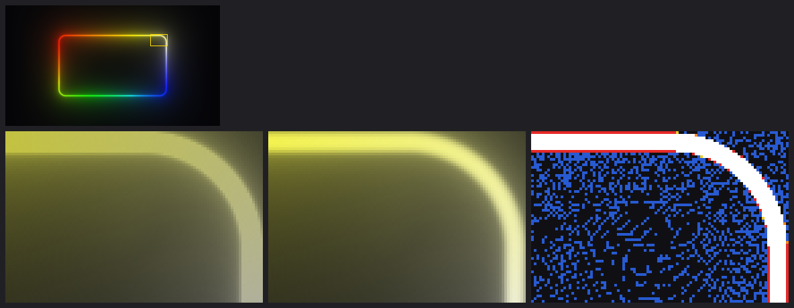
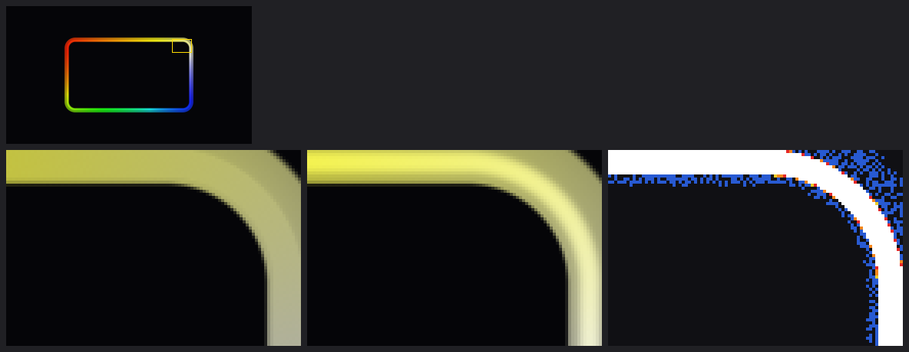
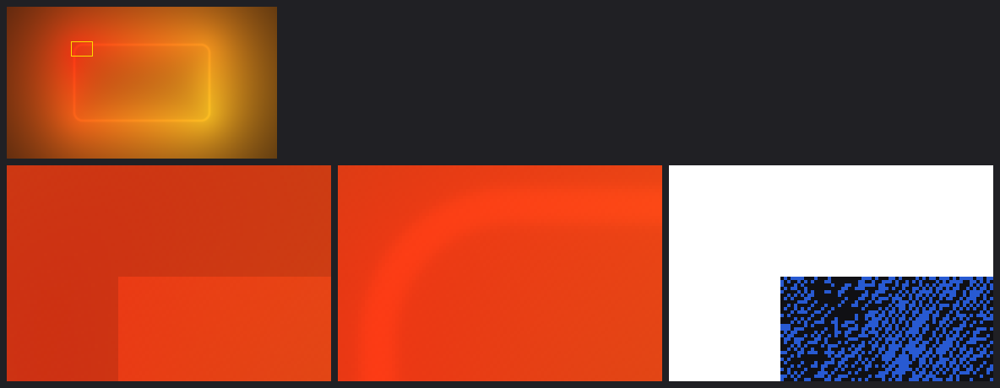
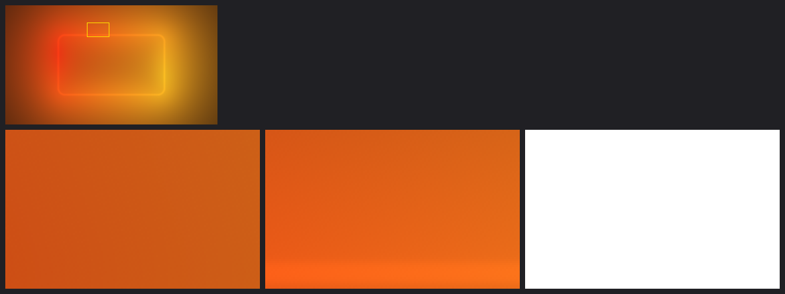
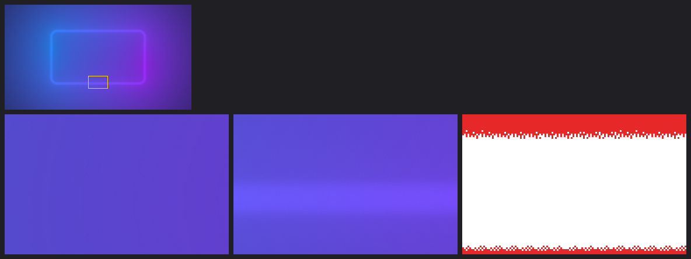
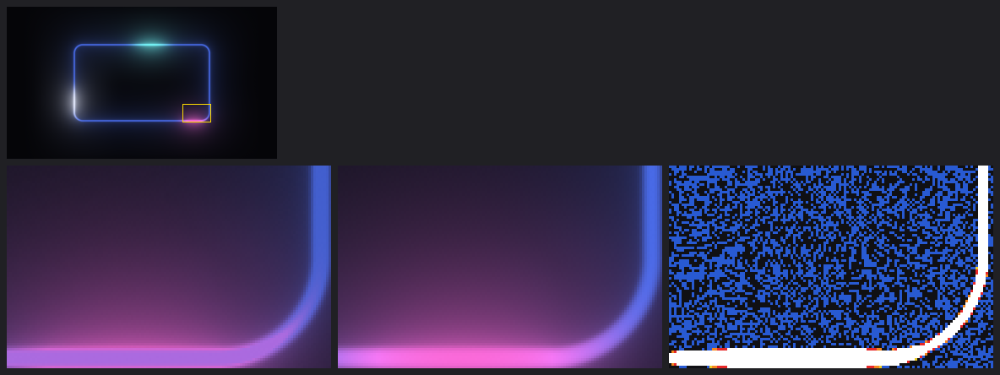
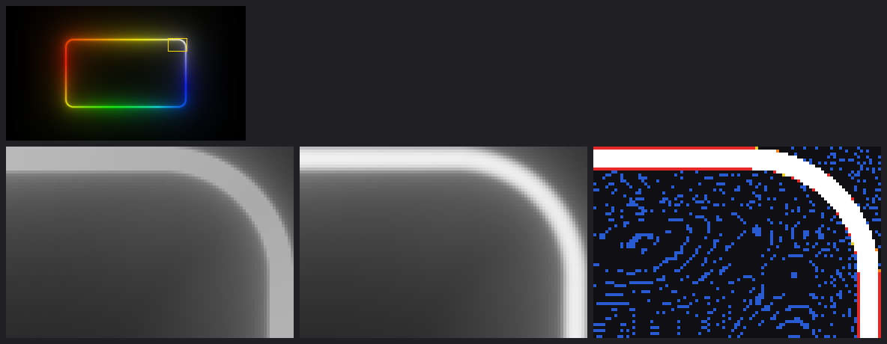

# Sampler precision: visual check

What marking the nine samplers of float and ten-bit buffers `highp` (I111 in
[`review-findings.md`](../records/review-findings.md)) changes on screen. On
desktop GL nothing, by construction - and measured byte for byte. On a GLES
driver, what it prevents depends on how that driver implements `lowp`, so
this page draws the worst case the spec allows, built and rendered on the
Mac, against the frame the fix guarantees. Why the change was made is in
[`progress-log.md`](../records/progress-log.md) (2026-11-17); the rule it
leaves is in `CLAUDE.md`, beside the one for uniform arrays.

**Result: on desktop GL the change moves no pixel - 114 probe frames and
11,220 `fuzz` frames byte-identical. Simulated at the minimum `lowp` GLSL ES
allows, the build before it would have drawn the line up to 80 levels dimmer
and washed out on every neon scene, and on frames with the hue rotating it
flattens the whole glow - 32-42% of the lit pixels off by more than a level
on `overdrive`, `soft_wash` and `bounded_band`.** Nearly all of that is one
sampler, `uField`: the fields store brightness before the tone map, which
runs well past 2, and a lowp fetch clamps at 2. The other eight samplers move
the frame by 2 levels at most. A driver that runs `lowp` as 16-bit float - as
many mobile GPUs do - fetches a half-float buffer exactly, and would have
drawn the correct frame either way; whether the Tizen device is one of them
is not known.

## 1. What is being compared

| side | build | the nine samplers |
| ---- | ----- | ----------------- |
| before | `45ad100` | no precision qualifier: GLSL ES's default, `lowp` |
| after | working tree, I111 | `highp` |
| simulated lowp | `45ad100`, every fetch from the nine rounded and clamped | what a GLES driver may return for the "before" side |

The nine are `uEmission` (the gather's emission table), `uGlowCover` and
`uSegCover` (the glow coverage tables), `uGather` / `uGatherSeg` (the gather
buffer, read by the shading and by the field composites), `uField` (the
glow's and the edge ring's fields) and `spotlight-blit.frag`'s `uSource`. The
neon's and the flare's blits were made `highp` with the ten-bit buffers (I109)
and are not part of this comparison. All Release, Apple M2 Pro.

## 2. Method

The scratch probe of
[`ten-bit-buffers-visual-check.md`](ten-bit-buffers-visual-check.md) section 2,
with three more sets of scenes: the spotlight alone (two lamps), and six
`check` scenes with the hue rotating (`hueRotationRate` 0.5, a fixed 1/60 s
step) over the dark clear and over a transparent one - the only frames that
read the glow's own field, which the still frames never do. 114 frames in
all, each scene at 1.0, 0.5 and 0.25 (the hue scenes at 0.5 and 0.25).

**Desktop.** The probe built against each of `45ad100` and the working tree,
and every frame compared byte for byte; `fuzz` seeds 1 to 3 likewise
(`--write` from a build of `45ad100`, `--against` from the working tree's).

**The simulation.** GLSL ES 3.00 section 4.5.1 requires of a `lowp` float only
the range (-2, 2) and an absolute precision of 2^-8. A detached worktree of
`45ad100` had every fetch from the nine samplers (13 call sites) wrapped in

```glsl
vec4 lowpq(vec4 v) { return clamp(floor(v * 256.0 + 0.5) / 256.0, vec4(-2.0), vec4(2.0)); }
```

so the frame it draws is what the "before" build draws on a driver that gives
a `lowp` sampler no more than the spec promises. A second variant wrapped
`uField` alone, to say which sampler the damage comes from. Both against the
working tree's frames.

**How to read the figures.** As in the ten-bit page: top left, the whole frame
at 1/4 size with a yellow box on the magnified patch; below it, the simulated
lowp frame, the working tree's frame, and the difference - per pixel, the
largest change in any colour channel: near black none, blue 1 level, yellow 2,
orange 3-4, red 5-8, white more than 8.

## 3. Desktop: nothing moves

| | frames | differing |
| - | ------ | --------- |
| probe: every `check` scene, five scenes over bright, grey and transparent backgrounds, the tail, the flare, the spotlight, six scenes with the hue rotating | 114 | 0 |
| `fuzz` seeds 1, 2, 3 | 11,220 | 0 |

Desktop GL gives precision qualifiers no meaning, so this is the expected
result; it is also the check that the edit itself - nine declarations and
their comments - changed nothing else.

## 4. What lowp would draw

Worst frame in each group, simulated lowp against the working tree:

| group | frames | largest change | alpha | lit pixels off by more than 1 | `uField` alone, largest |
| ----- | ------ | -------------- | ----- | ----------------------------- | ----------------------- |
| still, dark | 36 | 80 | - | 0.6-31.9% | 79 |
| still, bright | 15 | 59 | - | 1.1-10.4% | 60 |
| still, grey | 15 | 68 | - | 1.0-10.3% | 67 |
| still, transparent | 15 | 80 | 66 | 1.0-10.4% | 80 |
| hue rotating, dark | 12 | 80 | - | 1.8-42.0% | 79 |
| hue rotating, transparent | 12 | 80 | 66 | 1.8-42.0% | 80 |
| `tail` (intensity 0.1) | 3 | 1 | - | 0% | 1 |
| flare | 3 | 0 | - | 0% | 0 |
| spotlight | 3 | 1 | - | 0% | 0 |

The last column is the variant that rounds `uField` and nothing else: it
reproduces every group's damage to within a level. A third variant rounded
the gather, emission and coverage samplers and not `uField` (measured on the
still scenes): no frame moved by more than 2 levels - their values are
colours and coverages encoded `c / (1 + c)`, inside the range, where 2^-8 is
under a level once shaded. The spotlight's blit, rounded with everything
else, moved at most 1: its buffer holds output in [0, 1]. The dim `tail`
never brings a field past 2.

### 4.1 Still frames: the edge ring's field

The edge ring is re-shaded at full resolution on every frame and, on still
frames, composited from its own field (pass 2r). The field holds `Fa`, the
brightness before the tone map, which on the line itself is many times 2.
Clamped at 2, the tone map's shoulder sees a far dimmer line.



The default look at its top-right corner. The line comes out dim and
greyish-yellow; the glow just inside the ring moves by a level here and
there. The ring is drawn at full resolution at every scale, which is why a
still scene moves nearly the same at 1.0, 0.5 and 0.25.



`bounded_band`: the glow is cut to a narrow band, nearly all of it inside the
ring, so 32% of its lit pixels move.



`overdrive` (`intensity` 3, `bloomStrength` 1.5): the field is still above 2
well past the line, while the blit beside the ring reads the reduced buffer,
which no lowp sampler clamps - so the two meet in a hard-edged step, the
rectangle in the left panel.

### 4.2 Hue rotating: the glow's own field

With the hue rotating, the whole glow - not only the ring - is composited from
a field (pass 1c), and every texel of it past 2 is clamped.



`overdrive` with the hue rotating, a patch of the outer glow: under lowp the
gradient toward the line is gone, the glow a flat sheet. 42% of the lit
pixels are off by more than a level, 38% by more than 8.



`soft_wash` with the hue rotating, across the bottom edge: the line itself is
lost in the wash (32% of lit pixels off by more than a level, 20% by more
than 8).



`segments` with the hue rotating, at the pink boost: the boost's line dims,
and the glow around it moves by a level throughout (12% of lit pixels off by
more than a level, 1.1% by more than 8).

### 4.3 Coverage alpha

Over a transparent target the layer's coverage is its alpha - the brightest
channel, clamped to 1 - and a compositor blending the layer over video reads
it. It drops with the colour.



The default look with the hue rotating, its alpha drawn as grey: up to 66
levels lower on the line.

## 5. What this does not cover

- **A real GLES device.** The simulation is the floor the spec sets; a driver
  may give `lowp` more, and many run it as 16-bit float, which holds a half
  float exactly. Reading the Tizen device's `glGetShaderPrecisionFormat` for
  `GL_LOW_FLOAT` would say which kind it is; nothing here has.
- **The 8-bit LUT samplers** (`uGradientLUT`, `uSegmentLUT`, `uArcLUT`), which
  keep the default: their texels are levels of 1/255 in [0, 1], which the
  lowp floor of 2^-8 nearly but not exactly holds. Not simulated.
- **Every other GLES difference** - `#version 300 es`, the extensions a half
  float target needs, the format walks' 8-bit rows: see
  [`render-target-format-check-plan.md`](render-target-format-check-plan.md)
  and `neon-scale-check formats`.

## 6. Reproducing it

Build the probe as in the ten-bit page's section 8. For the simulation, in a
detached worktree, insert `lowpq` (above) after the declaration of each of the
nine samplers' files and wrap each fetch - `texture`, `textureLod` or
`texelFetch` of one of them - in it; rebuild that tree's `edge-lighting` (the
shaders are embedded at build time) and link the probe against it. A missing
`highp` on a new float-buffer sampler shows up only this way or on a device.
