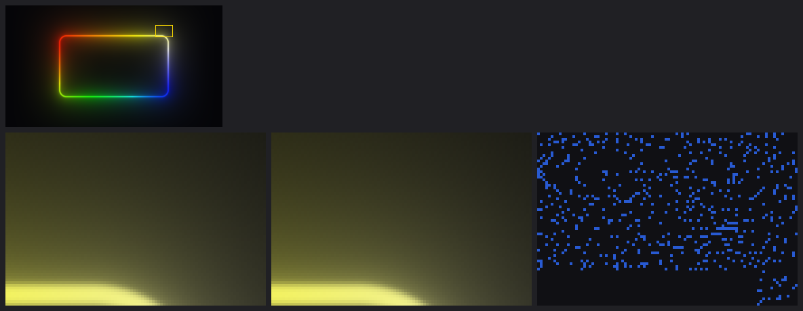
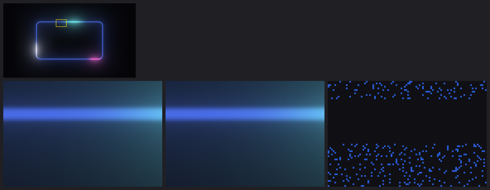
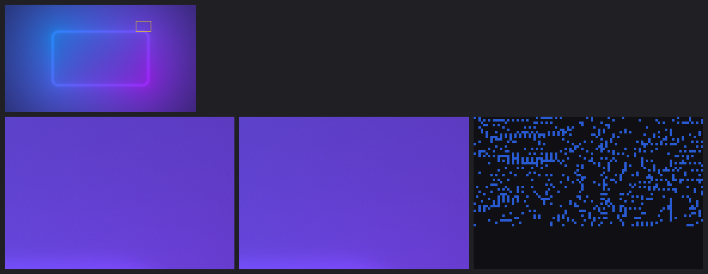
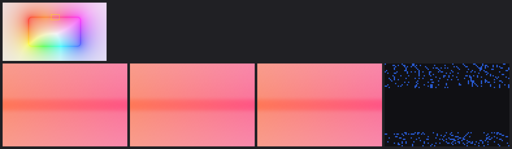
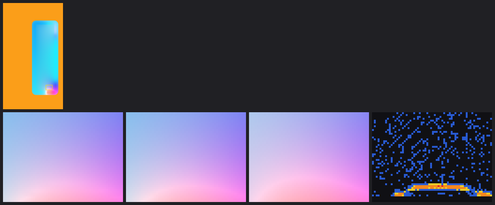
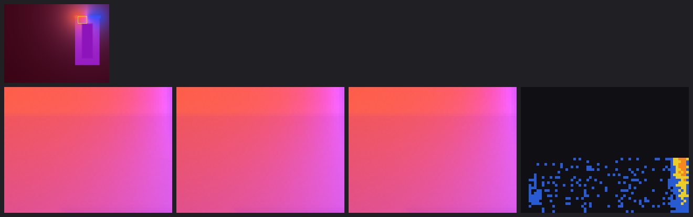
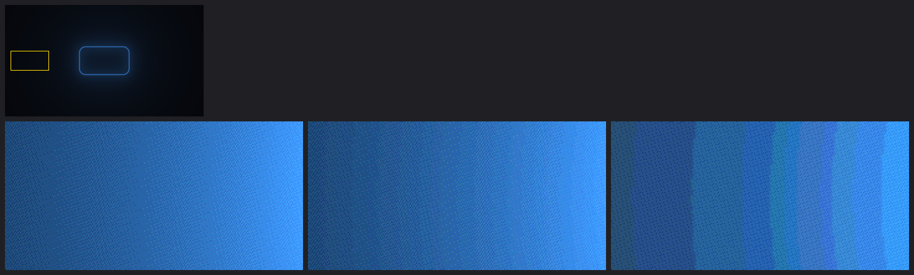
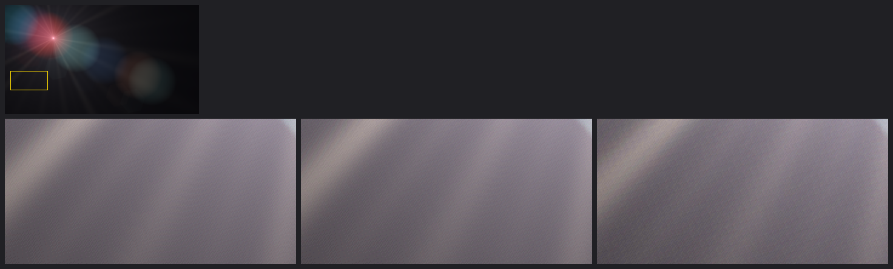

# The ten-bit reduced buffers: visual check

What the frame looks like after the neon's reduced buffer and the lens flare's
scaled buffer went from `RGBA16F` to `RGB10_A2` (I109 in
[`review-findings.md`](../records/review-findings.md)), measured against the
build before it, scene by scene, with figures. Why the change was made, what it
saves and what a host has to know are in
[`progress-log.md`](../records/progress-log.md) (2026-11-16) and
[`upgrade-notes.md`](../guides/upgrade-notes.md) section 14. The glow field's
idle release made in the same change (I110) moves no pixel, so nothing here is
about it.

**Result: on every fixed scene - 87 frames, every `check` scene, a wide faint
tail, five scenes over bright, grey and transparent backgrounds, the flare, at
scales 1.0, 0.5 and 0.25 - no pixel moved by more than 1 level, and alpha by
at most 1.** Between 3% and 19% of the lit pixels moved by exactly 1, which is
the buffer rounding to a quarter level where half float rounded far below it;
the output dither turns that into a different pattern of noise, not a visible
change. The dark tail keeps its dither: ten bits measure within 0.12 of a
level of half float where eight bits miss by up to 0.44 and draw contour
rings. The only larger moves are rare: on 49 of 1,494 random-config frames,
2 to 5 levels on at most 0.02% of the lit pixels, where the hue changes inside
one buffer texel over a coloured background (section 4).

## 1. What is being compared

| side | build | reduced buffers |
| ---- | ----- | --------------- |
| before | `5d1c044` | `RGBA16F`, alpha stored |
| after | working tree, I109 + I110 | `RGB10_A2`; the blits rebuild alpha as `max(r, g, b)` |

Both Release, on an Apple M2 Pro. A Debug build against a Release one moves
pixels by a level from CPU rounding alone (see `tools/neon-scale-check/README.md`,
`fuzz`), so both sides were built the same way.

## 2. Method

A scratch probe, not checked in, built twice: once against the library built
from `5d1c044` in a detached worktree, once against the working tree's. It
drives `EdgeLightingEffect` with the neon (and the flare for its scenes), sets
each scene's config, renders four frames at a fixed 1/60 s step through
`OffscreenCapture` at 1280 x 720, and writes the last frame's raw RGBA. The
hue does not rotate and colour transitions are instant, so a frame is a
function of the config alone: two runs of the same build are byte-identical.

The scenes:

- every `neon-scale-check check` scene (`tools/neon-scale-check/src/scenes.h`),
  over the harness's own dark clear, rgb(5, 5, 8);
- `tail`: a 320 x 180 rect with a wide, faint glow (`glowRadius` 40,
  `bloomStrength` 0.4, `intensity` 0.1), whose far tail falls through the last
  few levels over hundreds of pixels - where a level is crossed only every
  tens of pixels, which is what the output dither (R7) is for;
- `default`, `arcs`, `segments`, `soft_wash` and `rainbow` (eight saturated
  hues round the ring) over a bright clear (0.92, 0.92, 0.95), a grey one
  (0.45, 0.45, 0.47) and a transparent one, where the coverage alpha decides
  how much of the background shows;
- the lens flare alone;

each at `resolutionScale` 1.0, 0.5 and 0.25 (the neon has one path at every
scale, so 1.0 changed too: its buffer is full size). With `RGB10_A2` refused
through the effect's `FormatAvailability`, the after build also rendered the
`tail` and the flare with the reduced buffers on their RGBA8 rows - what eight
bits would have cost (section 5).

The worst random-config frames (section 4) were replayed with a scratch copy
of `neon-scale-check fuzz` that dumps them, and the same configs at 1.0, from
both builds.

**How to read the figures.** Top left is the whole frame at 1/4 size, with a
yellow box marking the patch the panels below show, magnified so one block is
one screen pixel. Panels run before, after, and - where there is one - the
1.0 frame, then the difference: per pixel, the largest change in any colour
channel, coloured by size:

| colour | change |
| ------ | ------ |
| near black | none |
| blue | 1 level |
| yellow | 2 levels |
| orange | 3-4 levels |
| red | 5-8 levels |

## 3. Every scene

Worst pixel of any frame in each group, and the share of the lit pixels that
moved by exactly 1 (none moved by more):

| background | scale | frames | largest change | alpha | moved by 1 |
| ---------- | ----- | ------ | -------------- | ----- | ---------- |
| dark | 1.0 | 13 | 1 | 0 | 5.9-19.3% |
| dark | 0.5 | 13 | 1 | 0 | 3.8-13.8% |
| dark | 0.25 | 13 | 1 | 0 | 3.0-15.5% |
| bright | 1.0 / 0.5 / 0.25 | 15 | 1 | 0 | 9.7-16.0% |
| grey | 1.0 / 0.5 / 0.25 | 15 | 1 | 0 | 9.7-15.7% |
| transparent | 1.0 / 0.5 / 0.25 | 15 | 1 | 1 | 10.8-18.6% |
| flare | 1.0 | 1 | 0 | 0 | 0% (no buffer at 1.0) |
| flare | 0.5 / 0.25 | 2 | 1 | 0 | 11.9-13.0% |

The 1-level moves are scattered single pixels wherever the glow is lit,
saturated pixels excepted: the dither adds the same noise in both builds, and
a value a quarter level away from where half float had it lands on the other
side of a rounding boundary now and then. They follow no edge and draw no
contour.

The default look at 0.5: the glow at the top-right corner. Before and after
cannot be told apart; the difference is a scatter of 1-level pixels.

`segments` at 0.5, where a white boost meets the blue base: the line itself
does not move at all - its pixels are saturated - and the halo either side
moves by 1 here and there.

`soft_wash` at 0.25 - a wide, bright bloom, at the coarsest scale tested.

## 4. Over a coloured background

The rebuilt coverage is `max(r, g, b)` of the colour the blit filtered; the
stored alpha was the filtered `max(r, g, b)` of each texel. Where the hue is
the same across the four texels the filter reads, the two are equal. Where it
changes inside them, the rebuilt one is smaller - the maximum of an average is
never more than the average of the maxima - and over a coloured background
that much more of the background shows through.

`rainbow` over the bright clear at 0.25, with the before build's 1.0 frame
third. Even eight saturated hues round the ring change too slowly for this to
show: the gather already blends colour over a kernel many texels wide, so the
hue inside one texel is nearly constant. Nothing moved by more than 1.

What does reach it comes from `fuzz` seed 1 - random configs over random
backgrounds: two hues meeting in a bright glow, at a coarse scale, over a
coloured clear. 49 of the 1,494 frames that differed reached 2 to 5 levels, on at most
0.02% of their lit pixels. The two worst, replayed:

`seq 460`: 640 x 1136, `resolutionScale` 0.25, an orange clear. The moved
pixels are the bright arc along the bottom of the crop, where cyan, blue and
pink meet. Third panel: the same config at 1.0.

`seq 27`: 800 x 600, `resolutionScale` 0.125, a purple clear. The moved
pixels run down the right edge of the crop, where a pink glow meets a blue
one.

Against each build's own 1.0 frame (the same config, a fresh effect; the two
builds' 1.0 frames differ by at most 1):

| frame | pixels moved by 2+ | before: mean / max off 1.0 | after: mean / max off 1.0 | closer to 1.0 | further |
| ----- | ------------------ | -------------------------- | ------------------------- | ------------- | ------- |
| seq 27 | 64 (46 by 2, 12 by 3, 6 by 4) | 2.8 / 5 | 1.2 / 3 | 63 | 0 |
| seq 460 | 111 (47 by 2, 34 by 3, 28 by 4, 2 by 5) | 11.7 / 28 | 12.0 / 29 | 15 | 43 |

So the change is neither consistently toward the 1.0 frame nor away from it:
closer on one, a wash on the other, whose pixels sit 12 levels from 1.0 at
that scale whichever buffer drew them. Over black (every dark scene above,
and the 306 frames of `generate --set cover`) nothing moves by more than 1.

## 5. Why ten bits, and not eight

The dither needs the buffer to hold the gradient finer than a level: in RGBA8
the far tail is rounded to one-level plateaus before the blit reads it, and
noise of half a level on an exact level rounds back to it. Ten bits hold a
quarter level, half float far finer. The panels below are the far tail with
its levels above the background multiplied by 20, so that one level is a
visible step: half float, ten bits, eight bits.

The `tail` scene at 0.5, left of the rect, where the glow is 1 to 5 levels
above the background. Eight bits draw a ring at every level; ten bits and half
float draw a smooth ramp of noise. At 20 times contrast the ten-bit panel shows
faint vertical stripes the half-float one does not; the measure below puts
them at a tenth of a level.

The measure is the flare review's (V32): the 9 x 9 box mean of the brightest
channel's level above the background - which averages the dither out and
keeps any contour - against the same mean of the half-float build's 1.0 frame,
over the lit pixels of the region:

| scene | buffer | mean off | largest | pixels off by more than 1/4 level |
| ----- | ------ | -------- | ------- | --------------------------------- |
| `tail`, 0.5 | RGBA16F | 0.002 | 0.04 | 0% |
| `tail`, 0.5 | RGB10_A2 | 0.019 | 0.12 | 0% |
| `tail`, 0.5 | RGBA8 | 0.136 | 0.44 | 16.8% |
| flare, 0.5 | RGBA16F | 0.016 | 1.26 | 0.18% |
| flare, 0.5 | RGB10_A2 | 0.025 | 1.21 | 0.11% |
| flare, 0.5 | RGBA8 | 0.048 | 1.14 | 0.44% |

The flare's haze at 0.5, levels times 6. Its RGBA8 row dithers into the buffer
as well as in the blit (`uDither`), so even eight bits show no rings here,
only a coarser grain; the three are close. The largest box-mean errors, about
a level, are the same in all three formats, so they are where 0.5 and 1.0
differ, not banding.

## 6. Distance from the 1.0 frame, on average

Each build's reduced-scale frames against its own 1.0 frame, the mean largest
channel error over the lit pixels:

| group | before | after |
| ----- | ------ | ----- |
| dark, 0.5 | 0.004-0.043 | 0.062-0.194 |
| dark, 0.25 | 0.006-0.051 | 0.083-0.210 |
| bright / grey / transparent, 0.5 and 0.25 | 0.012-0.057 | 0.135-0.187 |
| flare, 0.5 / 0.25 | 0.061 / 0.129 | 0.142 / 0.206 |

About a seventh of a level further, on average: the 1-level flips of section 3
are not the same pixels at two scales, so they add up against each other. The
largest errors barely move: `neon-scale-check check`'s table against 1.0 is
the build before's but for two cells, `hairline` at 0.35 and `sharp_corners`
at 0.25 (largest 1 -> 2), and stays inside every bound.

## 7. What this does not cover

- **Other GPUs.** All of it is the Apple M2 Pro. The AMD Radeon Pro 5300M and
  a GLES device were not run. On GLES the blits' samplers are now `highp`
  (GLSL ES gives `sampler2D` lowp by default, which need not carry ten bits);
  desktop GL ignores the qualifier, so nothing here tested it.
- **A reader of the shared buffer that reads alpha.** The library's readers
  and the tools rebuild it; a host's own renderer that read `.a` sees 2 bits.
  Nothing here draws one.
- **The spotlight**, whose buffer is unchanged.
- **Moving frames** are covered elsewhere: `generate --set cover` and `diff`,
  306 frames of animated arcs and segments, none more than 1 level off, 100%
  of lit pixels within 1 (`progress-log.md`).

## 8. Reproducing it

The probe is a program of about 250 lines in the shape of the one in
[`glow-side-comparison.md`](glow-side-comparison.md) section 2: a hidden GLFW
window, `EdgeLightingEffect` with `GetFormatAvailability()->SetRefusedFormats`
for the eight-bit run, `OffscreenCapture`, raw RGBA out. Build the before side
in a detached worktree (`git worktree add --detach <scratch>/before 5d1c044`,
then `cmake --build` its `edge-lighting` and `glad` targets in Release) and
link the probe against each tree's `build/lib/libedge-lighting.a` and
`build/lib/generated`. For a quicker gate that needs no probe, `neon-scale-check
generate --set cover` from each build and `neon-scale-check diff` between the
two directories reproduces section 3's dark-background result on moving
frames.
