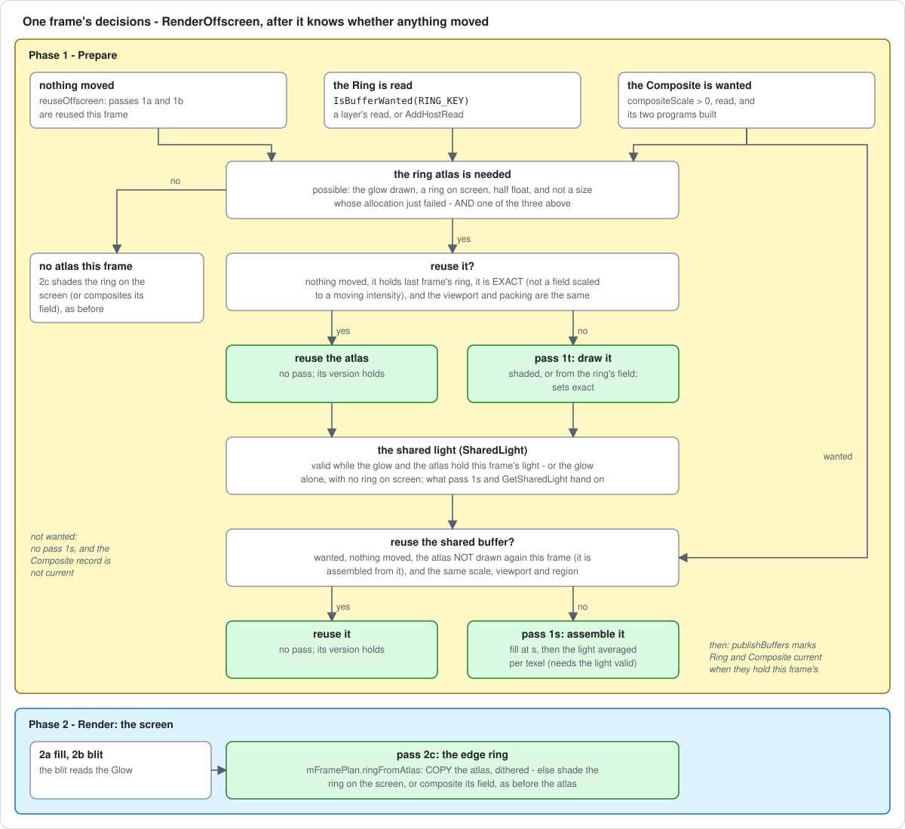

# Sharing the neon's picture

New to it? Read [`neon-shared-buffer-explained.md`](neon-shared-buffer-explained.md)
first: how the shared buffer fits among the neon's other parts, part by part,
with two frame-by-frame examples.

A plain-language guide to how another layer, or your own code, can use what
the neon draws: the two **parts** (`NeonRenderer.Glow` and `NeonRenderer.Ring`)
and the one flat **shared buffer** (`NeonRenderer.Composite`). When this page
and the code disagree, the code wins - each product's contract is beside its
key in [`neon-renderer.h`](../../lib/include/renderer/neon-renderer.h).

Sections 1-3 are for a reader; section 4 is how the neon renderer itself
makes, uses, reuses and releases the pieces, frame by frame. How it got this
way, step by step, and the changes since are in the
[progress log](../history/progress-log.md) (2026-10-17 and 2026-10-18); what it
costs, in [`neon-shared-layer-perf-review.md`](../history/neon-shared-layer-perf-review.md).

The diagrams are SVG files in
[`images/neon-shared-buffer/`](../images/neon-shared-buffer/), drawn by
`diagrams.py` there: edit the script and run
`python3 docs/images/neon-shared-buffer/diagrams.py`, not the SVGs.

---

## 1. The idea in one picture

The neon's picture on the screen is made of three pieces:

| piece | what it is | where it lives |
| ----- | ---------- | -------------- |
| glow | the soft halo and bloom | a texture, `NeonRenderer.Glow` (the reduced buffer) |
| ring | a thin band round the rect's edge with the sharp line | a texture, `NeonRenderer.Ring` (the **ring atlas**) |
| fill | the opaque fill under the glow, if `opaqueMode` is on | drawn from the config; no texture |

The screen is drawn **from the two textures**: the glow is scaled up onto it
(the blit), and the ring is copied onto it. So those two textures already ARE
the neon's light. Sharing it means handing them over - nothing is drawn twice.


Two ways to read it:

1. **The parts** - for a layer of this library, or a host that can run our
   shader code. It samples the glow and the ring atlas itself, with the
   shader chunk `neon-light.glsl`. Nothing extra is drawn for it, beyond
   keeping the ring in its atlas on moving frames.
2. **The shared buffer** - for a host that needs ONE plain texture (to hand to
   a compositor, say). The neon assembles it from the parts in one cheap
   pass: no shading.

What a reader gets either way: premultiplied colour over transparent black,
**not** dithered (add your own if you write it to 8 bits).

---

## 2. Reading the parts (free)

**Step 1 - say you read the ring** (the glow is drawn every frame anyway):

```cpp
effect.AddHostRead(NeonRenderer::RING_KEY);   // a layer declares it in CollectReads instead
```

Without the read, the ring atlas is only drawn on still frames; on a frame
where something moves, the neon shades the ring straight onto the screen and
there is no atlas to read.

**Step 2 - after `effect.Render(w, h)`**, take the inputs and draw with them:

```cpp
const NeonRenderer::SharedLight &light = neon->GetSharedLight();
if (light.valid)
{
    myShader.Use();
    NeonRenderer::UploadSharedLight(myShader, light, /*glowUnit*/ 0, /*ringUnit*/ 1);
    // ... draw
}
```

**Step 3 - in your fragment shader**, put `ShaderSource::NEON_LIGHT_GLSL`
after your `#version` line and call:

```glsl
vec4 light = neonLight(gl_FragCoord.xy, 1.0);   // caller px, y up; 1 = full-res pixel
```

`neonLight` returns exactly the light the screen got at that pixel, before the
dither: the ring's own pixels from the ring atlas, every other pixel from the
glow with the same edge mask the blit applies. It does not include the fill.
Asked for a point past the viewport, it returns the light at the nearest pixel
inside (`neonLightClampPx`): there is no screen there, and the ring atlas
stops at the viewport too. `neon-scale-check parts` checks this rebuild
against the screen on every scene, rects across the frame's edge included:
within 1 level everywhere (that is the screen's dither).

If something reads the parts on frames where something moves, check `valid`
on each frame. A rect wholly off-screen leaves the light as the glow alone:
`valid` is true, `ringTexture` is the glow's texture as a stand-in, and the
`NeonRenderer.Ring` record is not current.

The ring atlas is **packed** - four thin strips, the side ones turned
sideways - so it is not an image you can sample by position. `neonLight` (and
`neonRingTexel` in `neon-ring.glsl`) does the lookup.

---

## 3. Reading the shared buffer (one texture)

**Step 1 - choose a scale** (how sharp the texture is):

```cpp
Config cfg = effect.GetConfig();
cfg.neon.compositeScale = 0.5f;   // 0 = off; 1 = full resolution
effect.SetConfig(cfg);
```

**Step 2 - say you read it:**

```cpp
effect.AddHostRead(NeonRenderer::COMPOSITE_KEY);
```

**Step 3 - after `effect.Render(w, h)`:**

```cpp
const BufferRegistry &reg = effect.GetBufferRegistry();
const BufferRecord *rec = reg.Find(NeonRenderer::COMPOSITE_KEY);
if (rec && reg.IsCurrent(*rec))
{
    GLuint tex = rec->GetTexture();   // RGBA16F (RGBA8 on old drivers), LINEAR, clamp
    // A screen pixel p (caller px, y up) reads uv = (p - rec->origin) / rec->size.
}
```

It covers only the part of the screen the light and the fill can reach (the
whole viewport only for a fill that covers it), so always use `origin` and
`size`. Its size is rounded up to 16 texels: the extra texels inside the
viewport are 0, and those past the viewport's edge hold the light at that edge,
so a filtered read of the last row or column does not darken.
`rec->version` changes only when the picture changed.

What is in it:

- the fill (if any), then the light over it;
- each texel is the screen's light **averaged** over the square of screen
  pixels it covers - at scale 1 exactly the screen's pixel, below 1 the screen
  shrunk properly (a thin line keeps its width and brightness);
- `neon-scale-check shared` checks it against the screen, within 1 level:
  - at 1, with and without a fill;
  - at 0.5 and 0.4, against the screen averaged over each texel's square;
  - every texel, those past the viewport included;
  - still, hue and intensity frames.

**The scale** is clamped to `[max(resolutionScale, 0.4), 1]`
(`NeonRenderer::GetCompositeScale(config)` tells you what is used). The 0.4
floor is for the fill, which is drawn at the scale and needs room for its soft
edge; the light needs no floor.

**Cost**: 0.04-0.19 ms on a frame where something moves, on an Apple M2 Pro
at 1080p - against 0.016-0.033 ms for a reader of the two parts. Nearly all
of it is two more render passes, not shading, so read the parts if you can.
See [`neon-shared-layer-perf-review.md`](../history/neon-shared-layer-perf-review.md).

**Memory**: RGBA16F, 8 bytes a texel, over its region - at most 4.1 MB at 0.5
and 16.6 MB at 1 at 1920 x 1080 (66 MB at 1 at 4K, for a fill covering the
screen). Freed when the scale goes back to 0, the neon is disabled, or nobody
has read it for 5 seconds.

---

## 4. How the neon renderer uses them

### 4.1 The pieces, and who holds them

`NeonRenderer` owns every piece below; a reader only samples (rule 1 of
[`resource-sharing-plan.md`](../plans/resource-sharing-plan.md)).

| piece | member | what it holds | written by | read by | lives |
| ----- | ------ | ------------- | ---------- | ------- | ----- |
| **Glow** | `mScaledBuffer` - `NeonRenderer.Glow` (PUBLIC), and `NeonRenderer.Scaled` (DEBUG) | the halo and bloom at `resolutionScale`, tone-mapped, before the edge mask, without the filament | pass 1b, or 1c under a field | the blit (2b), pass 1s, readers | every frame the glow is drawn |
| **Ring atlas** | `mRingAtlas` (`RingAtlas`) - `NeonRenderer.Ring` (PUBLIC) | the edge ring's final premultiplied colours, undithered, packed into four strips (`RingFieldLayout`) | pass 1t | the copy (2c), pass 1s, readers | allocated on the first frame it is drawn |
| **Shared buffer** | `mComposite` (`CompositeTarget`) - `NeonRenderer.Composite` (PUBLIC) | the fill, then the light averaged per texel, at the shared scale, over its region | pass 1s | readers only - never the screen | while something reads it |
| **Shared light** | `mSharedLight` (`SharedLight`) | the two textures and everything a reader needs to read them: the glow's box, the ring's boxes and packing, the edge mask, the viewport | `RenderOffscreen`, after pass 1t | pass 1s (`UploadSharedLight`); `GetSharedLight` | rebuilt every frame |
| **Frame plan** | `mFramePlan.ringFromAtlas` | whether pass 2c copies the atlas | `RenderOffscreen` | `RenderOnscreen` | one frame |

The ring atlas's own state (`RingAtlas`, in
[`neon-renderer.h`](../../lib/include/renderer/neon-renderer.h)):

| field | meaning |
| ----- | ------- |
| `buffer` | the RGBA16F target, NEAREST; allocated in steps of 16 texels and kept while it holds the layout and is at most two steps over |
| `layout` | the packing it holds - where each strip sits on the viewport |
| `box`, `boxLayout` | the layout's box as one quad, drawn once per strip; re-uploaded only when the layout moves |
| `drawn` | it holds this frame's ring: drawn or reused |
| `exact` | what it holds is the ring as its own shading gives it, within a level - false when composited from a field scaled to a moving intensity |
| `viewport` | the viewport it was drawn for |
| `unavailable` | the driver cannot render half float: the ring goes to the screen directly, for good |
| `failedNeed` | a layout size whose allocation failed although half float renders: skipped until the size moves |
| `idleSeconds` | frame time spent allocated but neither drawn nor reused |

The shared buffer's (`CompositeTarget`): `buffer` (RGBA16F, RGBA8 where the
driver refuses), `lightMesh` (where the light is assembled), `scale` (the
clamped scale the mesh was built for), `cache` (the reuse key: drawn, scale,
viewport, region - written in one place), `wanted`, `unwantedSeconds`.

**Programs.** Five, each an object of its own: a program that draws one
target in one blend state per frame, by the AB rule (one program drawing an
offscreen buffer unblended and the screen blended measured 93-624x slower on
the AMD driver).

| program | source | draws | built |
| ------- | ------ | ----- | ----- |
| `mRingAtlasShader` | `neon.frag`, `uDither` 0 | the ring, shaded, into the atlas (1t) | the first frame of a config whose hue does not rotate, or the first frame the atlas is needed |
| `mRingFieldAtlasShader` | `neon-field.frag` + `NEON_FIELD_RING`, `uDither` 0 | the ring's field into the atlas (1t) | the first frame pass 1t composites the field |
| `mRingCopyShader` | `neon-field.frag` + `NEON_RING_COPY` | the atlas onto the screen, dithered (2c) | with `mRingAtlasShader` |
| `mCompositeFillShader` | `black-rect.frag` | the fill into the shared buffer (1s) | the first frame the shared buffer is wanted |
| `mAssembleShader` | `neon-assemble.frag` (with `neon-light.glsl`) | the light into the shared buffer (1s) | with it |

**Meshes.** `mRingAtlas.box` (pass 1t, per strip); `mRingMesh`, the screen
ring, which the copy draws over through the blit's matrix, so the copy and the
blit tile the screen exactly as the shaded ring and the blit do;
`mComposite.lightMesh`, the blit's boxes (`mBlitBounds`) grown by one texel of
the shared scale.

### 4.2 The passes

Every frame runs in two phases (see [`architecture.md`](architecture.md)):
**Prepare** draws into the neon's own textures, **Render** draws the screen.

| pass | phase | writes | when |
| ---- | ----- | ------ | ---- |
| 0, 0b | Prepare | emission and glow-coverage tables | when their inputs change |
| 1a | Prepare | gather buffer | when something it reads moved |
| 1b / 1c | Prepare | **Glow** (reduced buffer) | when something moved |
| 1r | Prepare | ring field (a cache) | moving frames, some configs |
| **1t** | Prepare | **Ring** (ring atlas) | when the atlas is needed and cannot be reused (4.3) |
| **1s** | Prepare | **Composite** | when it is wanted and cannot be reused (4.3) |
| 2a | Render | screen: fill | every frame |
| 2b | Render | screen: blit of Glow | every frame |
| 2c | Render | screen: ring - a **copy** of the atlas when it holds this frame's ring, else shaded on the screen (or its field composited) | every frame |

### 4.3 One frame, decision by decision

`RenderOffscreen` decides, in this order, once it knows whether anything
moved - `reuseOffscreen`: passes 1a and 1b are reused because no config,
time, table or viewport they read has changed:



1. **Is the shared buffer wanted?** Its scale is above 0, something reads it
   (`IsBufferWanted`), and its two programs build. If so, its region for this
   frame is computed (`getCompositeRegion`).
2. **Where does the ring lie?** `computeRingFieldLayout` packs the ring on
   this viewport. With no ring pixel on the screen there is nothing to pack
   (`ringAbsent`).
3. **Is the atlas needed?** It must be possible - the glow drawn, a ring on
   the screen, half float, and not a size that just failed to allocate. Then
   it is needed if nothing moved, if something reads the Ring, or if the
   shared buffer is wanted (which is assembled from it).
4. **Are its programs built?** Built when needed, or on a config whose hue
   does not rotate (7 in 4.6).
5. **Reuse it, or draw it?** Reused when nothing moved, it holds last frame's
   ring, that ring is exact, and the viewport and packing are the same.
   Otherwise pass 1t draws it.
6. **The ring's field** (pass 1r) is not decided on a frame that reuses or
   first draws the atlas while nothing moved - so a still config never bakes
   the field.
7. **Reuse the shared buffer, or assemble it?** Reused when nothing moved,
   the atlas was NOT drawn again this frame, and the scale, viewport and
   region are the same. Otherwise pass 1s assembles it.
8. **The passes run**: 0 / 0b, 1a, 1b or 1c, 1r, then **1t** if drawn - shaded
   by `mRingAtlasShader`, or composited from the ring's field by
   `mRingFieldAtlasShader` when the field serves; it sets `exact`.
9. **The shared light** is filled in: valid when the glow and the atlas hold
   this frame's light, or the glow alone when there is no ring on the
   screen. Then **1s** runs if it is to be drawn and the light is valid.
10. **What crosses to phase 2 and to readers:** `mFramePlan.ringFromAtlas`,
    the atlas's `drawn` / `exact` / `viewport` / `layout`, the shared
    buffer's cache key, the records marked current (`publishBuffers`: Ring
    when the atlas holds this frame's, Composite when drawn or reused), and
    `mSharedLight`.

Then `RenderOnscreen` draws the fill, the blit, and pass 2c: the copy
(`renderRingCopyPass`) when `ringFromAtlas`, otherwise the ring shaded on the
screen or its field composited, as before the atlas.

### 4.4 What each kind of frame does

| frame | pass 1t | pass 1s | pass 2c | `Ring` current | `Composite` current |
| ----- | ------- | ------- | ------- | -------------- | ------------------- |
| the first frame nothing moved, nobody reading | draws (shaded) | - | copy | yes | - |
| every still frame after it | reused | reused, if read | copy | yes | if read |
| something moved, nobody reading | - | - | shaded on the screen (or its field) | no | - |
| something moved, the Ring read | draws (shaded, or its field) | - | copy | yes | - |
| something moved, the Composite read | draws | draws | copy | yes | yes |
| the frame an intensity animation stops, with a reader | draws again, exact | draws again | copy | yes | if read |
| a rect wholly off-screen | - | the glow alone | - (no ring) | no | if read |

### 4.5 Why the ring atlas is not drawn on every frame

The first version drew the ring into its atlas on every frame. On frames where
something moves, that cost 5-26% (clearing the atlas, four strip draws, the
copy) for a ring that no later frame would reuse. So now:

- **still frames**: the ring is drawn into the atlas once, then only copied -
  4-7% faster than before;
- **moving frames nobody reads**: the ring is shaded on the screen, exactly as
  before;
- **frames somebody reads**: the ring goes into the atlas and is copied - the
  only extra cost of sharing (0.016-0.033 ms on an Apple M2 Pro at 1080p).


### 4.6 The rules that keep the parts honest

Each is a promise the code keeps today. A change that breaks one breaks every
reader, so the gate that checks it is named.

1. **The screen's ring IS the atlas, dithered.** On a frame the atlas holds,
   pass 2c copies it texel for pixel over `mRingMesh`, through the blit's
   matrix: the copy and the blit tile the screen as the shaded ring and the
   blit do. A texel the ring's shading discarded is an exact 0, and the copy
   discards it again. Checked by `neon-scale-check partition` (the ring copied
   on half its configs) and `parts`.
2. **The atlas is reused only while exact.** Its reuse rides on
   `mOffscreen.reusable`, which tracks the glow's field alone. A ring
   composited from its field scaled to a moving intensity is drawn again on
   the frame the intensity stops (`RingAtlas::exact`), as the ring was before
   the atlas. Exercised by the `held` rows of `parts` and `shared`.
3. **The shared buffer is reused only with the atlas it was assembled from.**
   A frame that draws the atlas again assembles the shared buffer again.
4. **Nothing past the viewport is read from the atlas.** Its packing is
   clipped to the viewport while the ring's annulus runs on.
   `neonLightClampPx` reads a point past the edge at the nearest pixel
   inside, which is also what fills the shared buffer's texels past the edge.
   Checked by `shared` on the rects across the frame's corner, every texel
   included.
5. **The shared light is invalid until it holds this frame's.** It is cleared
   at the top of every frame and on every release of a texture it names
   (the layer disabled, the idle atlas released).
6. **One reader code, one upload.** Pass 1s assembles with `neonLight`, the
   chunk a host includes, fed by `UploadSharedLight`, the upload a host
   calls. So `shared` checks the assemble pass and `parts` the chunk, and
   the neon and a reader cannot disagree on a uniform.
7. **The atlas programs' first frame.** Linking `mRingAtlasShader` costs
   ~5 ms on the M2. It is built on the first frame of a config whose hue does
   not rotate, so a still host pays with every other program rather than as a
   hitch on its second frame. A rotating hue never holds still while the
   clock runs, so it builds them only when the atlas is first needed. The hue
   is the one signal a first frame has, and it misses in two cases, each
   costing 5 ms once:
   - a still hue under an animation that never stops builds them for nothing;
   - a rotating hue whose clock is paused builds them on the first paused
     frame.

### 4.7 Pass 1s: the assemble pass

Pass 1s draws two things into the shared buffer:

1. the **fill**, at the shared scale, with the screen fill's own code
   (`drawFill`);
2. the **light**, over the area it can reach (`mComposite.lightMesh`), with
   `neon-assemble.frag`: for each texel, it reads `neonLight` at every screen
   pixel the texel's square touches and averages them, weighted by how much
   of each pixel the square covers.

No neon shading runs. Two shortcuts, both inside `shared`'s bound:

- **At scale 1** each texel touches exactly one screen pixel, so it IS that
  pixel's light: one read, no loop.
- **Below 1**, a texel whose square is more than a square's width from the
  ring, on a config with no edge mask live (no one-sided glow, no cutoff),
  reads the glow once at the square's centre instead of once per pixel. Away
  from the ring the glow is smooth, and the two differ by a fraction of a
  level.

**Its region.** The shared buffer covers texels of the shared scale's grid,
anchored at the viewport's corner, so texel q covers caller px
`[(origin + q) / s, (origin + q + 1) / s]`:

- the light's box (`mBlitBounds` grown by a texel) and the fill's band
  (`mFillOuter`), or the whole viewport for a fill that covers it;
- clipped to the viewport;
- its size rounded up to 16 texels, so a moving rect does not reallocate it
  every frame.

The rounding's texels inside the viewport are 0; past the viewport's edge they
hold the light at the edge (4.6, rule 4). Measured costs are in
[`neon-shared-layer-perf-review.md`](../history/neon-shared-layer-perf-review.md).

### 4.8 Lifetimes and failures

| event | ring atlas | shared buffer | shared light |
| ----- | ---------- | ------------- | ------------ |
| the layer disabled | released | released | invalid |
| `compositeScale` back to 0 | - | released | - |
| 5 s neither drawn nor reused | released (`RING_ATLAS_RELEASE_SECONDS`) | - | invalid |
| 5 s with nothing reading it | - | released (`COMPOSITE_RELEASE_SECONDS`) | - |
| no half-float target | `unavailable` for good: the ring is shaded on the screen | never made: it needs the atlas | the glow alone without a ring; invalid with one |
| an allocation fails, but half float renders (a 16 x 16 probe says so) | that size is skipped until it moves | not made on those frames | invalid on those frames |
| a program fails to build | logged once, never retried; the ring is shaded on the screen | not made | as above |

Releases happen in `OnConfigChanged` and `Update`, never in a frame's passes:
a frame must not delete a framebuffer it may still bind.

### 4.9 Who owns what

- `NeonRenderer` owns all three textures; readers only sample them.
- The records are PUBLIC: their contracts, beside the keys in
  `neon-renderer.h`, are promises the neon's future optimisations must keep.
- `PassRecorder` (the tools' draw spy) files pass 1t as `P1T`, pass 1s as
  `P1S`, and the copy as `P2C`.

---

## 5. Where things are in the code

| what | where |
| ---- | ----- |
| The keys and contracts | `GLOW_KEY`, `RING_KEY`, `COMPOSITE_KEY` - [`neon-renderer.h`](../../lib/include/renderer/neon-renderer.h) |
| The ring atlas | `RingAtlas mRingAtlas` (`exact`, `failedNeed`); `renderRingAtlasPass`, `drawRingStrips`, `renderRingCopyPass`, `ensureRingAtlasPrograms`, `ensureRingFieldAtlasProgram` - [`neon-renderer.h`](../../lib/include/renderer/neon-renderer.h), [`neon-renderer.cpp`](../../lib/src/renderer/neon-renderer.cpp) |
| The frame's decisions | `RenderOffscreen`: `ringAtlasPossible` / `Needed` / `Reused` / `Draw`, `compositeWanted` / `Reused` / `Draw`, the `SharedLight light` it fills; `mFramePlan.ringFromAtlas` |
| The parts API | `SharedLight`, `GetSharedLight`, `UploadSharedLight` |
| The reader's GLSL | [`neon-light.glsl`](../../lib/shaders/neon-light.glsl) (`neonLight`, `neonLightClampPx`, `neonLightSquareTouchesRing`), [`neon-ring.glsl`](../../lib/shaders/neon-ring.glsl) (`neonRingTexel`); `ShaderSource::NEON_LIGHT_GLSL` |
| The copy | [`neon-field.frag`](../../lib/shaders/neon-field.frag) under `NEON_RING_COPY` |
| The assemble pass | `renderCompositePass`, [`neon-assemble.frag`](../../lib/shaders/neon-assemble.frag), `getCompositeRegion`, `setupCompositeGeometry`, `ensureCompositePrograms` |
| Marks and releases | `publishBuffers`; `Update` (idle releases), `OnConfigChanged` (disable, scale 0) |
| The setting and its floor | `NeonConfig::compositeScale`, `COMPOSITE_MIN_SCALE`, `NeonRenderer::GetCompositeScale` - [`config.h`](../../lib/include/core/config.h) |
| Host reads | `EdgeLightingEffect::AddHostRead` / `RemoveHostRead` - [`edge-lighting.h`](../../lib/include/core/edge-lighting.h) |
| Checks | `neon-scale-check parts`, `shared`, `partition` ([README](../../tools/neon-scale-check/README.md)); the `shared/` scenes in `layer-check` |

---

## 6. Known limits

- Not in the C ABI yet - C++ only.
- Needs half-float render targets: without them the ring is drawn on the
  screen directly, the parts are not offered (with a ring on the screen), and
  the shared buffer is not made.
- One shared-buffer scale for every reader.
- Under a moving intensity the glow, and the ring when its field serves, are
  the field's composite scaled to the intensity: approximate while it moves
  (I56), exact again on the frame it stops.
- A reader's cost on a moving frame is one or two more render passes (the
  atlas; the shared buffer). That has been measured on an Apple M2 Pro only,
  not on a tile-based mobile GPU.
