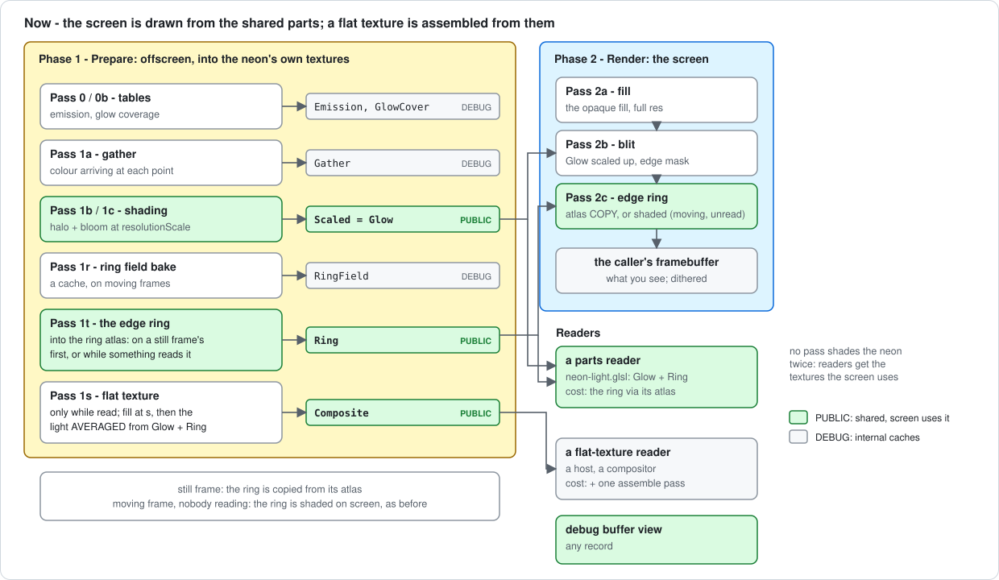
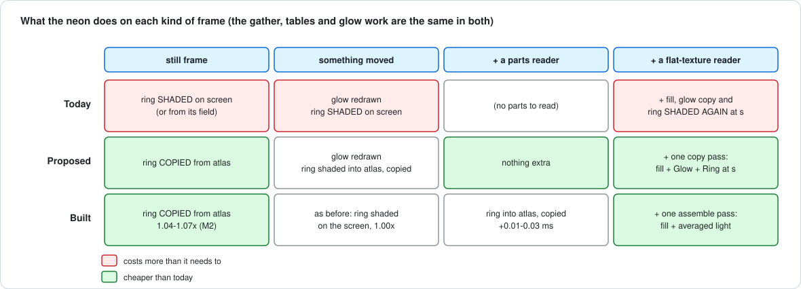

# Sharing the neon's picture

A plain-language guide to how another layer, or your own code, can use what
the neon draws: the two **parts** (`NeonRenderer.Glow` and `NeonRenderer.Ring`)
and the one flat **shared buffer** (`NeonRenderer.Composite`). When this page
and the code disagree, the code wins - each product's contract is beside its
key in [`neon-renderer.h`](../lib/include/renderer/neon-renderer.h).

How it got this way, with the measurements, is in
[`neon-shared-layer-plan.md`](neon-shared-layer-plan.md) and the progress log
(2026-10-17).

The diagrams are SVG files in
[`images/neon-shared-buffer/`](images/neon-shared-buffer/), drawn by
`diagrams.py` there: edit the script and run
`python3 docs/images/neon-shared-buffer/diagrams.py`, not the SVGs.

---

## 1. The idea in one picture

The neon's picture on the screen is made of three pieces:

| piece | what it is | where it lives |
| ----- | ---------- | -------------- |
| glow | the soft halo and bloom | a texture, `NeonRenderer.Glow` (the reduced buffer) |
| ring | a thin band round the rect's edge with the sharp line | a texture, `NeonRenderer.Ring` (the **ring atlas**) |
| fill | the opaque fill under the glow, if `opaqueMode` is on | drawn from the config; no texture |

The screen is drawn **from the two textures**: the glow is scaled up onto it
(the blit), and the ring is copied onto it. So those two textures already ARE
the neon's light. Sharing it means handing them over - nothing is drawn twice.



Two ways to read it:

1. **The parts** - for a layer of this library, or a host that can run our
   shader code. It samples the glow and the ring atlas itself, with the
   shader chunk `neon-light.glsl`. Nothing extra is drawn for it, beyond
   keeping the ring in its atlas on moving frames.
2. **The shared buffer** - for a host that needs ONE plain texture (to hand to
   a compositor, say). The neon assembles it from the parts in one cheap
   pass: no shading.

What a reader gets either way: premultiplied colour over transparent black,
**not** dithered (add your own if you write it to 8 bits).

---

## 2. Reading the parts (free)

**Step 1 - say you read the ring** (the glow is drawn every frame anyway):

```cpp
effect.AddHostRead(NeonRenderer::RING_KEY);   // a layer declares it in CollectReads instead
```

Without the read, the ring atlas is only drawn on still frames; on a frame
where something moves, the neon shades the ring straight onto the screen and
there is no atlas to read.

**Step 2 - after `effect.Render(w, h)`**, take the inputs and draw with them:

```cpp
const NeonRenderer::SharedLight &light = neon->GetSharedLight();
if (light.valid)
{
    myShader.Use();
    NeonRenderer::UploadSharedLight(myShader, light, /*glowUnit*/ 0, /*ringUnit*/ 1);
    // ... draw
}
```

**Step 3 - in your fragment shader**, put `ShaderSource::NEON_LIGHT_GLSL`
after your `#version` line and call:

```glsl
vec4 light = neonLight(gl_FragCoord.xy, 1.0);   // caller px, y up; 1 = full-res pixel
```

`neonLight` returns exactly the light the screen got at that pixel, before the
dither: the ring's own pixels from the ring atlas, every other pixel from the
glow with the same edge mask the blit applies. It does not include the fill.
Asked for a point past the viewport, it returns the light at the nearest pixel
inside (`neonLightClampPx`): there is no screen there, and the ring atlas
stops at the viewport too. `neon-scale-check parts` checks this rebuild
against the screen on every scene, rects across the frame's edge included:
within 1 level everywhere (that is the screen's dither).

If something reads the parts on frames where something moves, check `valid`
on each frame. A rect wholly off-screen leaves the light as the glow alone:
`valid` is true, `ringTexture` is the glow's texture as a stand-in, and the
`NeonRenderer.Ring` record is not current.

The ring atlas is **packed** - four thin strips, the side ones turned
sideways - so it is not an image you can sample by position. `neonLight` (and
`neonRingTexel` in `neon-ring.glsl`) does the lookup.

---

## 3. Reading the shared buffer (one texture)

**Step 1 - choose a scale** (how sharp the texture is):

```cpp
Config cfg = effect.GetConfig();
cfg.neon.compositeScale = 0.5f;   // 0 = off; 1 = full resolution
effect.SetConfig(cfg);
```

**Step 2 - say you read it:**

```cpp
effect.AddHostRead(NeonRenderer::COMPOSITE_KEY);
```

**Step 3 - after `effect.Render(w, h)`:**

```cpp
const BufferRegistry &reg = effect.GetBufferRegistry();
const BufferRecord *rec = reg.Find(NeonRenderer::COMPOSITE_KEY);
if (rec && reg.IsCurrent(*rec))
{
    GLuint tex = rec->GetTexture();   // RGBA16F (RGBA8 on old drivers), LINEAR, clamp
    // A screen pixel p (caller px, y up) reads uv = (p - rec->origin) / rec->size.
}
```

It covers only the part of the screen the light and the fill can reach (the
whole viewport only for a fill that covers it), so always use `origin` and
`size`. Its size is rounded up to 16 texels: the extra texels inside the
viewport are 0, and those past the viewport's edge hold the light at that edge,
so a filtered read of the last row or column does not darken.
`rec->version` changes only when the picture changed.

What is in it:

- the fill (if any), then the light over it;
- each texel is the screen's light **averaged** over the square of screen
  pixels it covers - at scale 1 exactly the screen's pixel, below 1 the screen
  shrunk properly (a thin line keeps its width and brightness);
- `neon-scale-check shared` checks it against the screen, within 1 level:
  - at 1, with and without a fill;
  - at 0.5 and 0.4, against the screen averaged over each texel's square;
  - every texel, those past the viewport included;
  - still, hue and intensity frames.

**The scale** is clamped to `[max(resolutionScale, 0.4), 1]`
(`NeonRenderer::GetCompositeScale(config)` tells you what is used). The 0.4
floor is for the fill, which is drawn at the scale and needs room for its soft
edge; the light needs no floor.

**Cost**: 0.04-0.19 ms on a frame where something moves, on an Apple M2 Pro
at 1080p - against 0.016-0.033 ms for a reader of the two parts. Nearly all
of it is two more render passes, not shading, so read the parts if you can.
See [`neon-shared-layer-perf-review.md`](neon-shared-layer-perf-review.md).

**Memory**: RGBA16F, 8 bytes a texel, over its region - at most 4.1 MB at 0.5
and 16.6 MB at 1 at 1920 x 1080 (66 MB at 1 at 4K, for a fill covering the
screen). Freed when the scale goes back to 0, the neon is disabled, or nobody
has read it for 5 seconds.

---

## 4. How it fits into the neon's frame

### 4.1 The passes

Every frame runs in two phases (see [`architecture.md`](architecture.md)):
**Prepare** draws into the neon's own textures, **Render** draws the screen.

| pass | phase | writes | when |
| ---- | ----- | ------ | ---- |
| 0, 0b | Prepare | emission and glow-coverage tables | when their inputs change |
| 1a | Prepare | gather buffer | when something it reads moved |
| 1b / 1c | Prepare | **Glow** (reduced buffer) | when something moved |
| 1r | Prepare | ring field (a cache) | moving frames, some configs |
| **1t** | Prepare | **Ring** (ring atlas) | the first still frame, and every frame something reads it |
| **1s** | Prepare | **Composite** | while read and something moved |
| 2a | Render | screen: fill | every frame |
| 2b | Render | screen: blit of Glow | every frame |
| 2c | Render | screen: ring - a **copy** of the atlas, or shaded directly on a moving frame nobody reads | every frame |

### 4.2 Why the ring atlas is not drawn on every frame

The first version drew the ring into its atlas on every frame. On frames where
something moves, that cost 5-26% (clearing the atlas, four strip draws, the
copy) for a ring that no later frame would reuse. So now:

- **still frames**: the ring is drawn into the atlas once, then only copied -
  4-7% faster than before;
- **moving frames nobody reads**: the ring is shaded on the screen, exactly as
  before;
- **frames somebody reads**: the ring goes into the atlas and is copied - the
  only extra cost of sharing (0.01-0.03 ms on an Apple M2 Pro at 1080p).



### 4.3 Pass 1s: the assemble pass

Pass 1s draws two things into the shared buffer:

1. the **fill**, at the shared scale, with the screen fill's own code
   (`drawFill`);
2. the **light**, over the area it can reach (`mComposite.lightMesh`), with
   `neon-assemble.frag`: for each texel, it reads `neonLight` at every screen
   pixel the texel's square touches and averages them, weighted by how much
   of each pixel the square covers.

No neon shading runs. At scale 1 each texel touches exactly one screen pixel,
so it IS that pixel's light - one read, no loop. Below 1, a texel whose square
is more than a square's width from the ring, on a config with no edge mask
live (no one-sided glow, no cutoff), reads the glow once at the square's
centre instead of once per pixel: away from the ring the glow is smooth, and
the two differ by a fraction of a level (`neon-scale-check shared` holds
them within 1). See [`neon-shared-layer-perf-review.md`](neon-shared-layer-perf-review.md).

### 4.4 Who owns what

- `NeonRenderer` owns all three textures; readers only sample them (rule 1 of
  [`resource-sharing-plan.md`](resource-sharing-plan.md)).
- The records are PUBLIC: their contracts are promises the neon's future
  optimisations must keep. A change that makes the screen's ring differ from
  the atlas, or the glow from what the blit reads, breaks every reader.
- `PassRecorder` (the tools' draw spy) files pass 1t as `P1T` and pass 1s as
  `P1S`; `neon-scale-check partition` also tiles the ring's copy.

---

## 5. Where things are in the code

| what | where |
| ---- | ----- |
| The ring atlas and its pass | `RingAtlas mRingAtlas`, `renderRingAtlasPass`, `drawRingStrips`, `renderRingCopyPass` - [`neon-renderer.h`](../lib/include/renderer/neon-renderer.h), [`neon-renderer.cpp`](../lib/src/renderer/neon-renderer.cpp) |
| When the atlas is drawn | `ringAtlasDraw` in `RenderOffscreen` |
| The keys and contracts | `GLOW_KEY`, `RING_KEY`, `COMPOSITE_KEY` - [`neon-renderer.h`](../lib/include/renderer/neon-renderer.h) |
| The parts API | `SharedLight`, `GetSharedLight`, `UploadSharedLight` |
| The reader's GLSL | [`neon-light.glsl`](../lib/shaders/neon-light.glsl), [`neon-ring.glsl`](../lib/shaders/neon-ring.glsl); `ShaderSource::NEON_LIGHT_GLSL` |
| The assemble pass | `renderCompositePass`, [`neon-assemble.frag`](../lib/shaders/neon-assemble.frag), `getCompositeRegion`, `setupCompositeGeometry` |
| The setting and its floor | `NeonConfig::compositeScale`, `COMPOSITE_MIN_SCALE` - [`config.h`](../lib/include/core/config.h) |
| Host reads | `EdgeLightingEffect::AddHostRead` / `RemoveHostRead` - [`edge-lighting.h`](../lib/include/core/edge-lighting.h) |
| Checks | `neon-scale-check parts`, `shared`, `partition`; the `shared/` scenes in `layer-check` |

---

## 6. Known limits

- Not in the C ABI yet - C++ only.
- Needs half-float render targets: without them the ring is drawn on the
  screen directly, the parts are not offered and the shared buffer is not
  made.
- One shared-buffer scale for every reader.
- The ring atlas's two programs cost ~5 ms to build (M2). A config whose hue
  does not rotate builds them on its first frame, with every other program;
  a rotating hue builds them only on the first frame the atlas is needed, so
  the default config's first frame does not pay for them. See
  [`neon-shared-layer-perf-review.md`](neon-shared-layer-perf-review.md)
  section 7.
