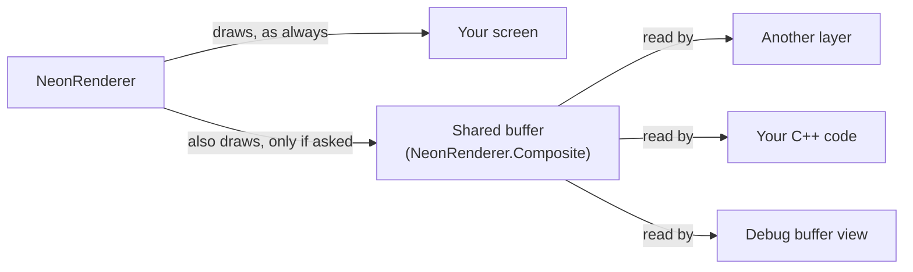
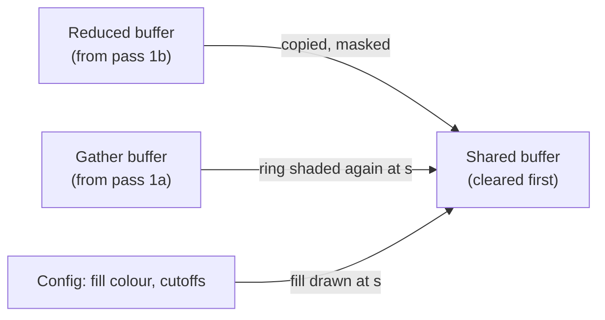
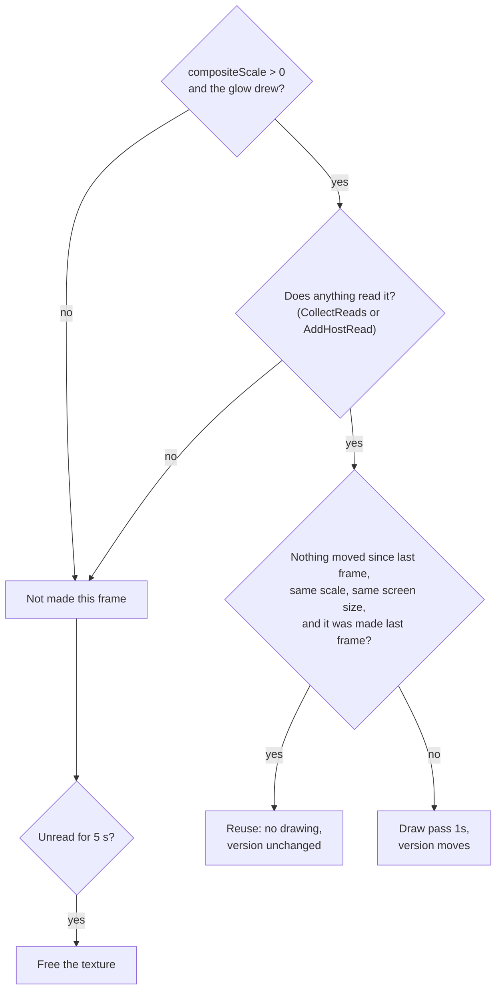

# The neon's shared buffer

A plain-language guide to `NeonRenderer.Composite`: what it is, how to use it,
and how it fits with the rest of the neon renderer. A redesign that makes it a
core part of the neon, shared at no extra cost, is proposed in
[`neon-shared-layer-plan.md`](neon-shared-layer-plan.md). When this page and the
code disagree, the code wins - the contract is beside `COMPOSITE_KEY` in
[`neon-renderer.h`](../lib/include/renderer/neon-renderer.h:397).

The diagrams are SVG files in
[`images/neon-shared-buffer/`](images/neon-shared-buffer/), drawn by
`diagrams.py` there: edit the script and run
`python3 docs/images/neon-shared-buffer/diagrams.py`, not the SVGs.

---

## 1. What it is, in one picture

Normally the neon draws straight onto your screen (the "caller's
framebuffer"). Nothing else can read what it drew there.

The shared buffer is a **second picture of the whole neon layer**, drawn into a
texture of its own, so another layer or your own code can use it - for
example to blur it, reflect it, or show it somewhere else.



What is in it:

- everything the neon layer puts on screen: the opaque fill, the halo and
  bloom, the bright line, the one-sided cut and the cutoffs;
- over a transparent background (premultiplied alpha), so you can draw it
  over anything with normal "over" blending;
- **no** dither noise (if you write it to an 8-bit target, add your own);
- it covers the whole viewport.

What it is **not**:

- It is not what the screen shows. The screen is always drawn directly; the
  shared buffer is an extra copy. Turning it on never changes a single pixel
  on screen.
- It is not in the C ABI yet - C++ only.

---

## 2. How to use it

Two steps. Both are needed.

**Step 1 - choose a scale** (how sharp the picture is):

```cpp
Config cfg = effect.GetConfig();
cfg.neon.compositeScale = 0.5f;   // 0 = off; 1 = full resolution
effect.SetConfig(cfg);
```

**Step 2 - say you will read it**:

```cpp
effect.AddHostRead(NeonRenderer::COMPOSITE_KEY);   // once; RemoveHostRead to stop
```

The buffer is drawn **only while something reads it**. If you set a scale but
nobody reads it, the neon draws nothing extra and spends no time on it.

**Then, every frame, after `effect.Render(w, h)`:**

```cpp
const BufferRegistry &reg = effect.GetBufferRegistry();
const BufferRecord *rec = reg.Find(NeonRenderer::COMPOSITE_KEY);
if (rec && reg.IsCurrent(*rec))
{
    GLuint tex = rec->GetTexture();   // RGBA16F (RGBA8 on old drivers), LINEAR, clamp
    glm::vec2 origin = rec->origin;   // where it sits on screen, px, y up: (0, 0)
    glm::vec2 size = rec->size;       // the screen area it covers, px
    // A screen pixel p reads the texture at uv = (p - origin) / size.
}
```

`rec->version` changes only when the picture changed, so you can skip work on
frames where it did not.

**Other readers:**

- Another renderer in the effect declares the read in its `CollectReads`
  (`out.Add(this, NeonRenderer::COMPOSITE_KEY, ReadPhase::RENDER)`) and binds
  the texture in its `Render`.
- The debug layer reads it when you pick `NeonRenderer.Composite` in
  **Debug > Buffer View** (the demo's "Shared Scale" slider sets the scale).

---

## 3. The scale

`compositeScale` is how big the buffer is compared with the screen.

| you set | it is drawn at | why |
| ------- | -------------- | --- |
| 0 | nothing | off |
| below `max(resolutionScale, 0.4)` | `max(resolutionScale, 0.4)` | see below |
| up to 1 | what you set | |
| above 1 | 1 | never bigger than the screen |

Two lower limits:

- **Not below `resolutionScale`.** The shared buffer copies its glow from the
  neon's reduced buffer, which is drawn at `resolutionScale`. Going coarser
  than that buffer would throw detail away for nothing.
- **Not below 0.4** (`NeonConfig::COMPOSITE_MIN_SCALE`). The soft edges are
  drawn one buffer-pixel wide. Below 0.4 a buffer pixel is so big that those
  edges stick out past the area the neon reserves for them, and get cut off.

`NeonRenderer::GetCompositeScale(config)` tells you the scale it will really
use.

**Memory** (RGBA16F, 8 bytes a pixel, whole viewport):

| screen | at 0.5 | at 1 |
| ------ | ------ | ---- |
| 1920 x 1080 | 4.1 MB | 16.6 MB |
| 3840 x 2160 | 16.6 MB | 66 MB |

It is freed when the scale goes back to 0, when the neon is disabled, or after
5 seconds with no reader (`COMPOSITE_RELEASE_SECONDS`).

---

## 4. How it fits into the neon's frame

### 4.1 The neon's passes, briefly

Every frame runs in two phases (see [`architecture.md`](architecture.md)):

1. **Prepare** - offscreen work, into the neon's own textures.
2. **Render** - drawing onto your screen.

Inside the neon (the edge ring, red, is the part pass 1s draws a second time):


The on-screen picture is three pieces laid together:

- the **fill** (if `opaqueMode` is on);
- the **blit**: the soft halo and bloom, from the reduced buffer, scaled up;
- the **ring**: a thin band around the rect's edge, shaded again at full
  resolution so the bright line stays sharp.

The blit and the ring never overlap - they tile the frame exactly (the
"partition").

### 4.2 What pass 1s does

Pass 1s draws **the same three pieces again**, into the shared buffer instead
of the screen, at the shared scale:



| piece | on screen (phase 2) | in the shared buffer (pass 1s) |
| ----- | ------------------- | ------------------------------ |
| fill | `renderFillPass`, full res | `drawFill` at scale s, same code |
| glow (blit) | the reduced buffer, scaled up and masked | the same reduced buffer, scaled to s and masked - **not shaded again** |
| sharp line (ring) | `neon.frag` at full res, from the gather | `neon.frag` again at scale s, from the same gather |
| dither | yes | **no** |

So the expensive part - the glow - is **copied**, not recomputed. Only the
thin ring band is shaded a second time.

Each of the three uses its **own program object** (`mCompositeFillShader`,
`mCompositeBlitShader`, `mCompositeRingShader`) even though they share code
with the screen's programs. That is the project's "AB rule": one program must
not draw two different targets in one frame (on the AMD driver that was up to
600x slower). They are linked from the shader cache, so no extra compile.

### 4.3 Where its pieces come from

The shared buffer has its own ring and blit areas, built by the **same
function** as the screen's (`GetRingBlitPair`), just for a different pixel
size. At scale 1 they are exactly the screen's. They are then clipped to the
screen's areas, so the shared buffer never needs a texel of the reduced buffer
or the gather that the screen did not already need - which is why turning it
on never makes the neon's own buffers bigger.

The fill reuses the screen's fill shape (`mFillMesh`), scaled.

Two small shader switches make the passes work at another scale without
changing the screen's output:

- `uDestScale` (in `neon.frag`): the soft edges are one pixel of the grid the
  result is finally seen at. 1 for the screen; s for the shared buffer.
- `uDither` (in `neon.frag` and `neon-blit.frag`): 1 for the screen, 0 for the
  shared buffer.

---

## 5. When it is drawn, reused or freed

Every frame, in phase 1:



- **Reuse** follows the neon's own rule for still frames: if the neon could
  skip its offscreen passes (`mOffscreen.reusable`), the shared buffer is
  still right and is not redrawn.
- A frame where it was **not made** wipes the "can reuse" memory, so after a
  gap it is always redrawn, never shown stale.
- Changing **only** `compositeScale` rebuilds only the shared buffer's areas
  (`setupCompositeGeometry`); the neon's own buffers and caches are kept.

It is marked current in the registry in **Prepare**, so any layer's `Render`
can read it, whatever the layer order.

---

## 6. What it costs

- **Nothing** while nobody reads it.
- While read: one clear, the fill, a copy of the glow, and the ring band shaded
  again - on frames where something moved. Still frames reuse it for free.
- Measured at scale 1, read by the host, on an Apple M2 Pro at 1080p (the
  "V2" column in the progress log, 2026-10-17): still frames about 1.05x the
  neon alone; moving frames 1.3-2.2x (hue 1.7x, intensity 2.2x, arc wipe 1.4x,
  travelling segment 1.3x), because the ring is shaded twice.

---

## 7. History you may see mentioned

- **The scale-1 copy** (removed 2026-10-17). At scale 1 the screen used to be
  a copy of the shared buffer instead of being drawn directly. It was timed:
  faster on still frames, slower on hue and intensity animations, and it
  needed a dozen special cases. It was removed; the screen is now always drawn
  directly.
- **Review fixes** (2026-10-16): the 0.4 floor, demand-only drawing,
  `AddHostRead`, one function for both mesh pairs. See the progress log.

---

## 8. Where things are in the code

| what | where |
| ---- | ----- |
| The setting and its floor | `NeonConfig::compositeScale`, `COMPOSITE_MIN_SCALE` - [`config.h`](../lib/include/core/config.h:464) |
| The key and its contract | `NeonRenderer::COMPOSITE_KEY` - [`neon-renderer.h`](../lib/include/renderer/neon-renderer.h:397) |
| Everything the pass owns | `CompositeTarget mComposite` - [`neon-renderer.h`](../lib/include/renderer/neon-renderer.h:1242) |
| Host read declaration | `EdgeLightingEffect::AddHostRead` - [`edge-lighting.h`](../lib/include/core/edge-lighting.h:134) |
| The drawn scale | `GetCompositeScale` - [`neon-renderer.cpp`](../lib/src/renderer/neon-renderer.cpp:1217) |
| Decide: draw, reuse or skip | `RenderOffscreen` - [`neon-renderer.cpp`](../lib/src/renderer/neon-renderer.cpp:2569) |
| Pass 1s itself | `renderCompositePass` - [`neon-renderer.cpp`](../lib/src/renderer/neon-renderer.cpp:4882) |
| Its ring and blit areas | `setupCompositeGeometry`, `GetRingBlitPair` - [`neon-renderer.cpp`](../lib/src/renderer/neon-renderer.cpp:4152) |
| Fill / blit shared with the screen | `drawFill`, `drawBlit` - [`neon-renderer.cpp`](../lib/src/renderer/neon-renderer.cpp:4977) |
| Its programs | `ensureCompositePrograms` - [`neon-renderer.cpp`](../lib/src/renderer/neon-renderer.cpp:3450) |
| Marking it current | `publishBuffers` - [`neon-renderer.cpp`](../lib/src/renderer/neon-renderer.cpp:5296) |
| Freeing it when unread | `NeonRenderer::Update` - [`neon-renderer.cpp`](../lib/src/renderer/neon-renderer.cpp:2389) |
| Tests | the `shared/` scenes in `layer-check` - [`README`](../tools/layer-check/README.md) |

---

## 9. Known limits

- The buffer always covers the whole viewport, even when the neon only lights
  a small band - memory could be saved by sizing it to the lit area.
- Below scale 1 it is a re-render, not a shrunk screenshot: the bright line
  keeps a minimum width in buffer pixels, so a 1 px line comes out about 2 px
  wide at 0.5.
- One scale for everyone: two readers cannot ask for two different scales.
- No check yet compares it with the screen numerically; the `layer-check`
  scenes only catch changes.
- The neon-scale-check tools (`partition`, `neon-guide-figures`) do not know
  about pass 1s and would misname its draws if it were turned on there.
