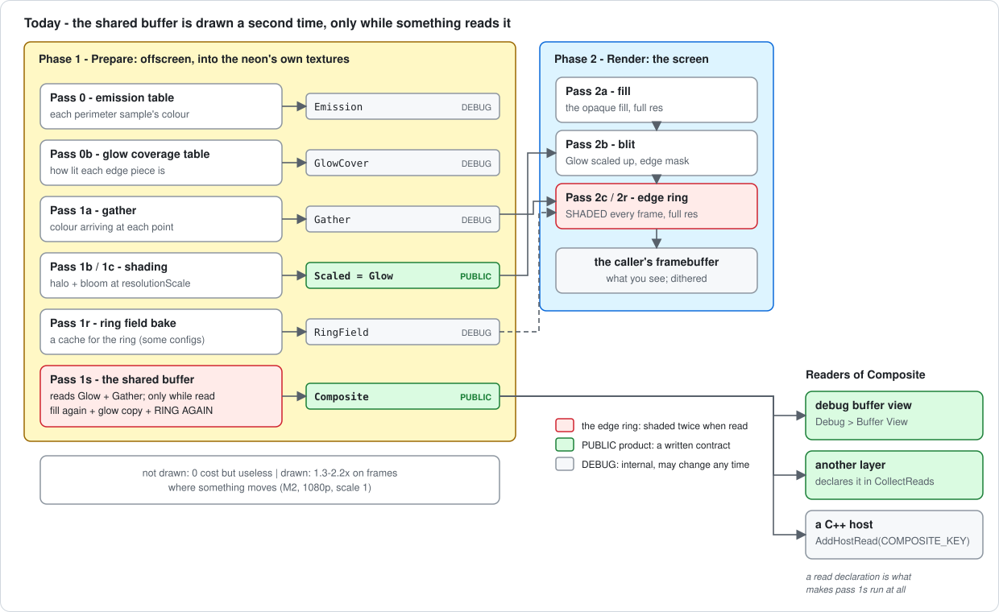
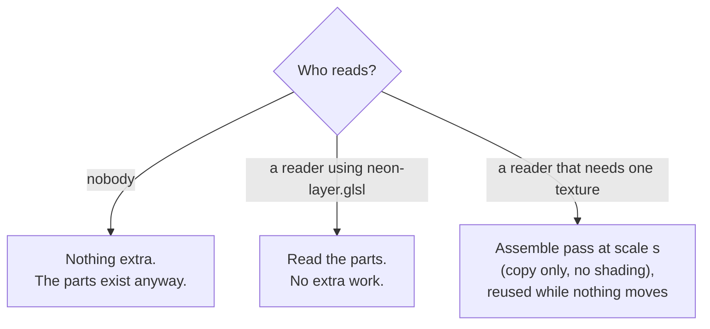

# Plan: the shared buffer as a core part of the neon

Status: BUILT, 2026-10-17 (steps 1-4), with the change to step 1 its own gate
forced. [`neon-shared-buffer.md`](neon-shared-buffer.md) describes the result;
this page keeps the reasoning and the proposal as it was.

---

## 1. The problem

Today the shared buffer (`NeonRenderer.Composite`) is an **extra drawing**:

- When nobody reads it, it does nothing - it is useless.
- When somebody reads it, the neon draws its layer **a second time** into it:
  the fill again, the glow copied again, and the sharp line (the "edge ring")
  **shaded again** - the expensive part. Measured on an Apple M2 Pro at 1080p,
  the neon then costs 1.3-2.2x on frames where something moves.

What we want instead: the shared buffer is something the neon **already
makes for itself**, every frame, as part of drawing the screen. When somebody
asks for it, the neon hands over what it already has - no extra drawing.

---

## 2. What the neon already keeps, and what it does not

The neon's on-screen picture is three pieces laid together:

| piece | what it is | is it in a texture today? |
| ----- | ---------- | ------------------------- |
| glow | the soft halo and bloom | **yes** - the reduced buffer, already shared as `NeonRenderer.Glow` |
| ring | a thin band round the rect's edge, full resolution, with the sharp line | **no** - drawn straight onto the screen, every frame, even when nothing moved |
| fill | the opaque fill under the glow | **no** - but it is a simple shape, cheap to redraw from the config |

So two thirds of the picture is already shareable. The missing piece is the
ring. It is also the piece that costs the most to draw twice.

---

## 3. The idea

**Draw the ring into a texture of its own, always, and draw the screen from
the textures.**

- The **ring atlas** is the edge ring drawn into a small texture instead of
  onto the screen. It uses the packing the ring's field already uses
  (`RingFieldLayout`): the ring is four thin strips, stored side by side, so
  it costs about 1 MB, not a whole screen.
- The screen is then: fill, blit of the glow (as today), and a **copy** of the
  ring atlas (new, cheap).
- Both textures are **always there**. A reader just reads them.

### Why this is cheaper, not dearer

- **Still frames get cheaper.** Today the ring is drawn on the screen every
  frame, even when nothing moved, because the screen is redrawn every frame -
  shaded in full, or rebuilt from its cached field (pass 2r), which still runs
  the tone map per pixel.
  With the atlas, the ring is shaded once and then only copied until
  something moves - the same trick the glow buffer already uses.
- **Moving frames cost about the same.** The ring is shaded once (into the
  atlas instead of the screen), plus a copy of a thin band.
- **Sharing costs nothing.** The reader reads the two textures that exist
  anyway.

### What a reader gets

Two ways, so every kind of reader is served:

1. **The parts (free).** A layer of this library, or a host that can run our
   shader code, samples the glow and the ring atlas directly with a new shader
   chunk, `neon-light.glsl`: `neonLight(pixel)` returns the neon's colour at
   that pixel - exactly what the screen got, before dither. The CPU side is one
   call, `NeonRenderer::UploadSharedLight(shader, GetSharedLight(), ...)`, like `UploadEdgeMask`
   today.
2. **One flat texture (cheap, on demand).** A host that needs a single plain
   texture (to hand to a compositor, say) asks for `NeonRenderer.Composite`
   as today. The neon **assembles** it from the parts: one simple pass, no
   shading - fill, glow, and the ring atlas copied in. At scale 1 it is the
   screen's neon pixels exactly; below 1 it is the parts shrunk properly
   (averaged), not re-shaded - so a thin line stays the right width, which the
   current design gets wrong (a 1 px line comes out 2 px wide at 0.5).

---

## 4. What changes in the neon

| today | after |
| ----- | ----- |
| pass 2c / 2r: ring shaded onto the screen every frame | pass 1r: ring shaded into the ring atlas, only when something moved; pass 2c: copy atlas to screen |
| ring field (pass 1r bake, 2r composite) composites onto the screen | the same field composites into the ring atlas |
| pass 1s: fill + glow + ring **re-shaded** at scale s | pass 1s: **assemble** from fill + glow + ring atlas, no shading |
| `mCompositeRingShader`, `uDestScale`, the shared ring's limits and mesh | removed |
| shared buffer: viewport-sized | assembled over the lit area only (the box the neon can light) |
| the 0.4 scale floor | kept for the glow's soft edges at first; revisited after step 3 |

Kept as they are: the gather, the glow buffer and its fields, the emission and
coverage tables, the fill code, the read declarations and `AddHostRead`, and
the rule that the screen never changes when sharing is turned on.

### Memory

| | today | after |
| - | ----- | ----- |
| always | glow buffer (~2 MB at 0.5, 1080p) | + ring atlas (~1 MB, RGBA16F, default rect at 1080p) |
| only when a single texture is asked for | 4.1 MB at 0.5 / 16.6 MB at 1 (whole viewport) | lit area only: less, depending on the rect |

The ring atlas is RGBA16F, like the glow buffer, so the screen copy can add
the output dither once, after reading it. On a driver that cannot render half
float the neon keeps drawing the ring straight to the screen as today, and the
parts are not offered (the flat texture still can be).

---

## 5. Steps

Each step ships on its own and is checked before the next.

**Step 1 - the ring atlas (the core change).** DONE 2026-10-17, with one
change from this plan, forced by its own gate: drawn on EVERY frame the atlas
made moving frames 5-26% slower, so it is drawn only on the first frame
nothing moved (still frames then copy it, 1.04-1.07x) and on frames something
reads it; other moving frames draw the ring on the screen as before. See the
progress log.
Draw the ring into the packed atlas in phase 1; copy it to the screen in
phase 2; skip re-shading it on frames where nothing moved.
- Reuses: `RingFieldLayout`, `computeRingFieldLayout`, the per-strip
  projections of pass 1r, and the strip lookup in `neon-field.frag`
  (`NEON_FIELD_RING`), which becomes the copy's lookup.
- Check: `neon-scale-check check` and `layer-check` within 1 level (going
  through a half-float texture may move a pixel by one level); `partition`
  passes (the copy covers exactly the old ring area).
- Measure: still, hue, intensity, arc-wipe and segment-travel frames on the
  M2 and the AMD, against `main` and this branch. **Stop here if moving frames
  get slower than today by more than a few percent.**

**Step 2 - share the parts.** DONE 2026-10-17. The chunk is `neon-light.glsl` (`neonLight`), the API `GetSharedLight` / `UploadSharedLight` - names chosen so they do not collide with `BaseRenderer::GetLayer`. The probe is `neon-scale-check parts`: within 1 level everywhere.
Register the ring atlas as a PUBLIC product (`NeonRenderer.Ring`) with its
layout; add `neon-layer.glsl` and `NeonRenderer::GetLayer` / `UploadLayer`.
- Check: a probe reader rebuilds the neon from the parts and matches the
  screen within the dither (1 level) everywhere - the same check the glow
  product passed (S6b).

**Step 3 - assemble the flat texture from the parts.** DONE 2026-10-17: `neon-assemble.frag`, a box filter of the screen's light from the parts; `neon-scale-check shared` within 1 level. The 0.4 floor stays, for the fill alone.
Replace pass 1s's re-shading with an assemble pass; remove the shared ring
program, `uDestScale` and the shared ring mesh; size the texture to the lit
area.
- Check: the flat texture at scale 1 equals the screen's neon before dither;
  below 1 it equals the screen averaged down (a new `neon-scale-check shared`
  check, which replaces the scratch probe).
- Measure: the cost of a reader asking for the flat texture - expected to be
  one cheap pass over the lit area, against 1.3-2.2x today.

**Step 4 - tools and docs.** DONE 2026-10-17: `PassRecorder` files `P1T` and `P1S`; `partition` copies the ring from its atlas on every other config; `neon-shared-buffer.md` rewritten around what was built (`current.svg`).
Teach `PassRecorder` the new passes, extend `partition` to the copy and the
assemble pass, rewrite `neon-shared-buffer.md`.

---

## 6. Risks and open questions

- **One more texture round trip for the ring on moving frames.** The ring is
  written to the atlas and read back instead of going straight to the screen.
  It is a thin band, so this should be small; step 1 measures it before
  anything else is built on it.
- **Tile-based GPUs (the Tizen targets).** The ring moves from phase 2 to
  phase 1, where the neon already has offscreen passes, so the screen is still
  drawn in one run. Not measured on a tiler.
- **The strips' seams.** The ring field's atlas once left a 1 px seam (V24),
  fixed by drawing each strip's whole box. The atlas inherits that fix; the
  `partition` gate has to cover the copy.
- **Question for you:** do the readers you have in mind run our shader code
  (then the parts are enough, and step 3 can wait), or do they need one plain
  texture (then step 3 matters)?
